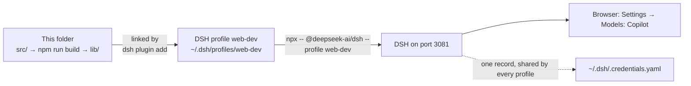

# Development

How to set up, build, test and run this plugin on a DSH profile. The rules for working here are in [AGENTS.md](AGENTS.md), the design in [docs/design/](docs/design/overview.md), and packaging and the differences from the official guide in [docs/packaging.md](docs/packaging.md).

Verified with DeepSeek Harness (DSH) `0.2.2-rc.1`, pi-ai `1.4.0` (DSH's own install carries `1.5.0`), Node `24.22` and pnpm `12.14`, on Linux.

## 1. How the pieces fit



- DSH is not a dependency of this folder. It runs from its own install, which `npx @deepseek-ai/dsh` creates in the npm cache (about 850 MB on first run).
- This folder is a **bundle**: `package.json` names `cordis.patch.yml`, which inserts the row `github-copilot-models` into a **profile** (`~/.dsh/profiles/<name>`). The bundle is linked, not copied.
- Credentials are kept per DSH home (`~/.dsh`), not per profile: a sign-in or sign-out on any profile applies to all of them (login.md B3).

## 2. Prerequisites and setup

You need Node.js 24 or later (the tests are TypeScript run by Node's type stripping), npm, pnpm (tested with 12.14; `dsh plugin` runs it in the profile folder) and Git.

```sh
npx -- @deepseek-ai/dsh --version   # 0.2.2-rc.1; engines.dsh allows >=0.2.2-rc.1 <0.3.0-0
git clone <this repository> dsh-github-copilot-models
cd dsh-github-copilot-models
npm install
npm run check                       # type-check, unit tests, build
```

Optional, for a live PAT test only: create `.env` (git-ignored) with a fine-grained personal access token that has the account permission **Copilot Requests**. Never print, log or commit it, and never start DSH from this folder (section 6).

```sh
COPILOT_GITHUB_TOKEN=github_pat_...
```

## 3. Profiles

| Way | Profile | Good for |
|---|---|---|
| In place | Your own profile, for example `web`, with this folder as a local link | Trying changes in your real setup. Every build reaches your everyday DSH at its next plugin reload or restart |
| Separate | A profile kept for development, `web-dev` on port 3081 (below) | Keeping your everyday DSH on a released version |
| Separate checkout | Your own profile keeps the link to the main checkout; work happens in another checkout (for example a git worktree), which `web-dev` loads for a browser check | Keeping work in progress out of your everyday DSH until it is merged |

A profile's `~/.dsh/profiles/<name>/package.json` shows how it has the plugin: `"dsh-github-copilot-models": "link:<this folder>"` for a local install, a version for one from npm.

**Install this folder in a profile:**

```sh
npx -- @deepseek-ai/dsh plugin --profile <name> add /absolute/path/to/dsh-github-copilot-models
```

This checks `engines.dsh`, runs `pnpm add`, records a `link:` dependency and appends the bundle. pnpm's warning about missing peer dependencies is expected: DSH supplies the peers at run time.

**Switching from npm:** `dsh plugin add <folder>` replaces an npm copy, while the Plugins page and the agent's `plugin_manager` refuse with "already installed". Back to npm: `dsh plugin --profile <name> remove dsh-github-copilot-models`, then `dsh plugin --profile <name> add dsh-github-copilot-models`, then restart that DSH. The login stays; the plugin's settings should too (not tested). Before a change that could break a profile with the local link, see the breaking-change rule in [AGENTS.md](AGENTS.md).

### Create the `web-dev` profile

Once per machine, from any folder (these commands never boot DSH):

```sh
# A fresh copy of the shipped web template. REPLACES an existing profile of that name.
npx -- @deepseek-ai/dsh --profile web-dev --from-default-profile web --dump-config > /dev/null

# Link this folder into it.
npx -- @deepseek-ai/dsh plugin --profile web-dev add /absolute/path/to/dsh-github-copilot-models

# Check: the composed tree ends with this plugin's layer.
npx -- @deepseek-ai/dsh --profile web-dev --dump-config | tail -3
#   # == dsh-github-copilot-models
#   - id: github-copilot-models
#     name: dsh-github-copilot-models
```

### Develop in a separate checkout

Another checkout's `lib/` reaches no profile, so a profile linked to the main checkout keeps its build until the work is merged and built there.

- **Browser check:** `npx -- @deepseek-ai/dsh plugin --profile web-dev add <checkout>`, run as in section 4, then point `web-dev` back at the main checkout.
- **No `.env`** comes along. For PAT steps run the main checkout's script against the other log: `npm run dev:host -- --log <checkout>/.tmp/web-dev.log save-pat`.

## 4. Run `web-dev`

```sh
mkdir -p .tmp/web-dev-cwd
cd .tmp/web-dev-cwd
npx -- @deepseek-ai/dsh --profile web-dev --port 3081 --no-open > ../web-dev.log 2>&1
```

- The log prints the launch URL with a fresh token: `dsh web: http://127.0.0.1:3081/?token=…`. Open it, close the first-run dialogs, then go to **Account menu → Settings → Models: Copilot**.
- **From a shell inside DSH** (for example an agent's terminal), prefix the command with `env -u DSH_PROFILE -u DSH_PROFILE_DIR -u DSH_SESSION_ID -u DSH_WEB_URL -u DSH_SHELL` so DSH's session variables do not leak in.
- Every start while a login is stored sends 2 requests (section 6). Sign out before stopping if the next start should send nothing.

**After a change:**

| You changed | Do |
|---|---|
| `src/host/`, `src/index.ts`, `src/shared/` (Host) | Stop `web-dev`, `npm run build`, start it, reload the page |
| `src/client/` only (Card) | `npm run build`; DSH picks up `lib/client.js` within a second, then reload the page |
| `cordis.patch.yml` or `package.json` | Restart `web-dev` |
| `locale/*.json` | Check the plugin's row under **Plugins → Installed plugins** |

**A rebuild while `web-dev` runs can reload the plugin.** `npm run build` always rewrites `lib/index.js`. The Card writes the profile's `cordis.patch.yml` on every toggle, size or header change; DSH then sees the new `lib/index.js` and reloads the plugin, which sends the 2 start-up requests. So keep `web-dev` stopped while the code is not ready, and stop it before a rebuild unless a reload is acceptable.

## 5. Build and test

```sh
npm run typecheck       # tsc, no emit
npm test                # unit tests over fakes (login.md A9, models.md A12)
npm run build           # lib/index.js (Host) and lib/client.js (Card)
npm run check           # all three
npm run test:contract   # offline checks of the installed DSH and pi-ai (login.md B7, models.md B9)
```

- **Unit tests** (`test/unit/`) use fake credentials, authorization and `fetch`, and hand-written `/models` rows. They need only `npm install`.
- **Contract tests** (`test/contract/`) load the real DSH packages and the plugin's adapter from DSH's install (set `DSH_INSTALL_DIR` for another one), with `fetch` and sockets blocked. Run them first after a DSH or pi-ai update: a failure means login.md or models.md part B is out of date.

## 6. Test against GitHub

> **Business PAT warning.** Do not send the fine-grained PAT of a Copilot Business account to the Individual endpoint `https://api.individual.githubcopilot.com`. This has blocked the account's access to GitHub Copilot for about an hour. Send requests only to the Copilot API host that the host lookup reports for the account (login.md A3).

Send live requests one at a time, and only when a test needs them; a coding agent asks the developer before each one ([AGENTS.md](AGENTS.md)).

| Action | Requests |
|---|---|
| Sign in with the browser | 7: pi-ai's device flow, token exchange, model list and model policy calls, then the plugin's host lookup and `/models` (login.md A3, models.md A3) |
| Save a PAT, Refresh, start `web-dev` or a plugin reload while a login is stored | 2: the host lookup (`GET https://api.<domain>/copilot_internal/user`) and `GET <Copilot host>/models` |
| A chat message on the plugin's route | 1 to `<Copilot host>`, plus 1 for the title of a new session |
| Sign out, open the page, switch a model, change a size or header | None |

With a browser login, pi-ai also refreshes a Copilot token that expires within 5 minutes when a request needs it (login.md B5).

**PAT test without a browser.** `scripts/dev-host.mjs` signs in to `web-dev` with the launch token from its log and calls the plugin's routes like the Card. It reads the PAT from `.env` and prints neither secret.

```sh
npm run dev:host -- state                  # no request
npm run dev:host -- save-pat               # 2 requests
npm run dev:host -- refresh                # 2 requests
npm run dev:host -- sign-out leak-check    # no request; counts the PAT in the DSH log (expect 0)
```

**Release test**, before each release. It installs the packed tarball, as users get it, in a throwaway DSH home on port 3082, so the test starts signed out and your own login and profiles stay untouched. From this folder (from a shell inside DSH, add the `env -u …` prefix of section 4):

```sh
mkdir -p .tmp/accept-cwd && npm pack --pack-destination .tmp   # builds; writes .tmp/dsh-github-copilot-models-<version>.tgz
ACCEPT_HOME="$PWD/.tmp/accept-home"
DSH_HOME="$ACCEPT_HOME" npx -- @deepseek-ai/dsh --profile accept --from-default-profile web --dump-config > /dev/null
DSH_HOME="$ACCEPT_HOME" npx -- @deepseek-ai/dsh plugin --profile accept add "$PWD/.tmp/dsh-github-copilot-models-<version>.tgz"
cd .tmp/accept-cwd
DSH_HOME="$ACCEPT_HOME" npx -- @deepseek-ai/dsh --profile accept --port 3082 --no-open > ../accept.log 2>&1
```

1. Open the launch URL in `.tmp/accept.log`. The Card shows Sign in. Sign in once, with a browser code or with the PAT (from this folder, in a second terminal: `npm run dev:host -- --log .tmp/accept.log save-pat`).
2. The account's models appear in the chat picker, with no visit to Settings → Models and no blank API key.
3. Send a request that streams and calls a tool.
4. Sign out: the plugin's models leave the picker. `npm run dev:host -- --log .tmp/accept.log leak-check` reports 0.
5. Stop DSH, then delete `.tmp/accept-home`, `.tmp/accept-cwd`, `.tmp/accept.log` and the tarball.

**Full login test**, when the login code changes, or DSH changes its `authorization` or `credentials` services: in the same setup, also sign in again after step 4 (the picker recovers without a restart), repeat steps 2 to 4 with the other method, and switch from one method to the other in both directions.

**Why DSH must not start from this folder.** A booting DSH loads `.env` from the folder it starts in and from `~/.dsh/.env`. pi-ai falls back to `COPILOT_GITHUB_TOKEN` whenever no login is stored (login.md B6), so a DSH started here would hand your PAT to its built-in GitHub Copilot route, and sign-out would report the token as still set. Config dumps and `dsh plugin` do not load `.env`.

## 7. Project layout

```text
package.json         bundle manifest: exports, files, engines.dsh, dsh.bundle, dsh.client
cordis.patch.yml     inserts the row github-copilot-models
locale/              title and description for the Plugins page
src/index.ts         Host entry: Config, routes, start-up lookup, the model route
src/host/            Login and Models controllers, host lookup, /models, pi-ai provider
src/client/          the Card (settings section) and its text in src/client/locales/
src/shared/api.ts    Card ↔ Host contract
scripts/             build.mjs (esbuild, with an import check), dev-host.mjs
test/unit/           over fakes
test/contract/       installed DSH and pi-ai, offline
docs/                design/, packaging.md, cicd.md, todo.md, study/
lib/, .tmp/          build output; web-dev log and start folder (git-ignored)
```

## 8. Troubleshooting

| Symptom | Cause and fix |
|---|---|
| `npm error EROFS … _cacache/tmp` | The npm cache is read-only (for example a sandbox). `npm install --cache ./.npm-cache` for this folder; `npx @deepseek-ai/dsh` needs its real cache. |
| `Unknown cli flags: --profile` | npx took the flag. Put `--` before the package: `npx -- @deepseek-ai/dsh --profile web-dev …`. |
| `config dumps take no app arguments` | Run `--dump-config` without app flags such as `--port`. |
| Startup refuses the plugin: `incompatible with dsh <version>` | `engines.dsh` does not match. Update it after running the contract tests on that version, or allow it once: `dsh plugin --profile web-dev allow-version dsh-github-copilot-models@<version> --dsh-version <dsh version> --accept-risk`. |
| No "Models: Copilot" in Settings | Run `npm run build`, or restart `web-dev` after linking. Check that `--dump-config` shows the row. |
| The Card says "Turn on DSH's llm-pi-ai plugin" | DSH's `llm-pi-ai` row is off in the profile. |
| "Could not reach the plugin's Host (HTTP 401)" | The browser is not signed in to this DSH. Open the launch URL from the log again. |
| Signed in without signing in on `web-dev` | The login is shared by every profile in the DSH home. |
| After sign-out the Card says `COPILOT_GITHUB_TOKEN` is set | It is in DSH's environment, `~/.dsh/.env`, or the start folder's `.env` (section 6). |
| Port 3081 in use | Another `web-dev` is running. |
| The lookup and `/models` ran without a restart | A plugin reload: a rebuild, then a Card setting change (section 4). |

## 9. Clean up

```sh
# Sign out first if a login is stored (Card, or npm run dev:host -- sign-out).
npx -- @deepseek-ai/dsh plugin --profile web-dev remove dsh-github-copilot-models
rm -rf ~/.dsh/profiles/web-dev
```

Sessions and logs from `web-dev` stay in `~/.dsh/sessions` and `~/.dsh/logs`.

## 10. Where to read more

- **Official:** [first plugin](https://deepseek-harness.github.io/deepseek-harness/en/develop/basic/), [config](https://deepseek-harness.github.io/deepseek-harness/en/develop/basic/config), [package and install](https://deepseek-harness.github.io/deepseek-harness/en/develop/basic/publish), [plugins and lifecycle](https://deepseek-harness.github.io/deepseek-harness/en/develop/framework/), [LLM adapters](https://deepseek-harness.github.io/deepseek-harness/en/develop/practice/llm-adapter), [settings card cookbook](https://github.com/deepseek-ai/deepseek-harness/blob/master/docs/cookbook/adding-a-settings-card.md).
- **Shipped with DSH**, in `<DSH install>/node_modules/@deepseek-ai/`: the plugin skill `dsh-agent-preset/skills/cordis-plugin-development/`, and the README and `lib/types/*.d.ts` of `dsh-authorization`, `dsh-credentials`, `dsh-client-connection`, `dsh-client-ui-settings`, `dsh-settings`, `dsh-llm-pi-ai`, `dsh-plugin-manager`.
- **Here:** [login.md](docs/design/login.md), [models.md](docs/design/models.md), [packaging.md](docs/packaging.md), [docs/study/](docs/study/), including the [official DSH docs](docs/study/official-dsh-docs.md).
