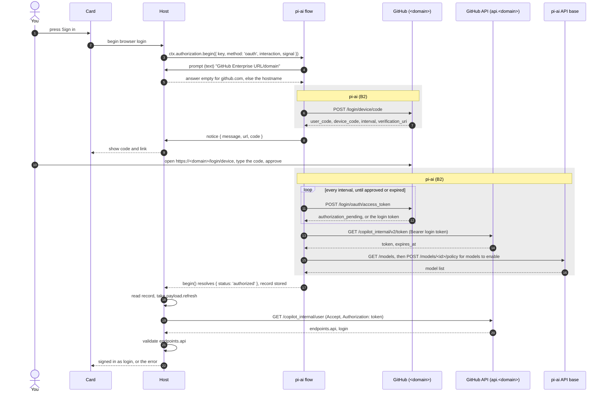
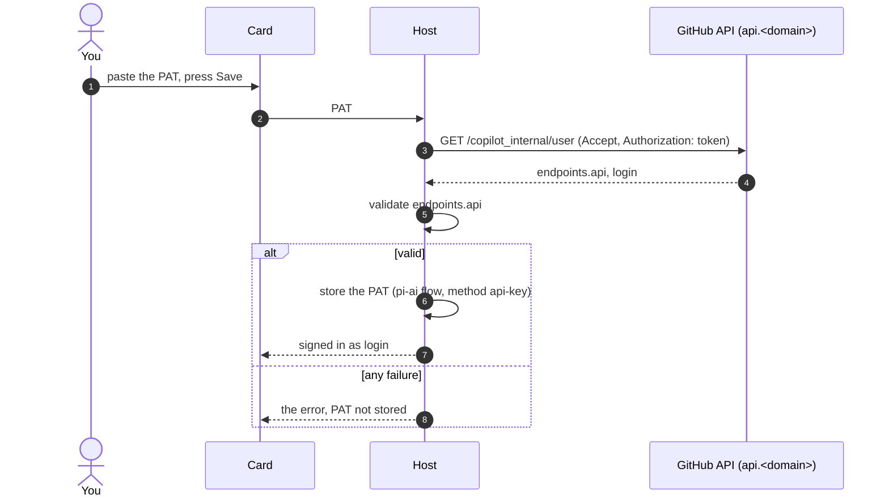

# Login

The login component signs the user in to GitHub Copilot by one of two methods, browser login or personal access token (PAT), and resolves the Copilot API host for the account. Its output is used by the Models component, which lists models and sends requests.

This document has three parts, split by who controls the behaviour:

| Part | Controlled by | Used by the plugin | Content |
|---|---|---|---|
| [A. What the plugin owns](#a-what-the-plugin-owns) | the plugin | yes | The plugin's own design. The maintainer decides it and can change it. |
| [B. What the plugin relies on](#b-what-the-plugin-relies-on) | DSH, pi-ai, GitHub | yes | Behaviour the plugin calls, depends on, or shows to the user. Re-check it when a version changes. |
| [C. Background only](#c-background-only) | DSH, pi-ai, GitHub | no | Facts found while studying. Nothing in the plugin depends on them. |

Sections are numbered by part (A1, B1, C1). A reference such as "B3" therefore shows straight away that the plugin does not own the behaviour.

## Terms

| Term | Meaning | See |
|---|---|---|
| Card | The plugin's settings card in the DSH web UI. It never receives a token. It talks to the Host only through routes registered with `ctx.connection.fetch.register`, which DSH authenticates. Its location and layout: [ui.md](ui.md). | A10 |
| Host | The plugin's server-side code, running inside DSH. | A |
| `<domain>` | The GitHub domain, from the Domain field. | A1 |
| Copilot host | The origin of the Copilot API for the account, as returned in `endpoints.api`. It differs by plan. | A3 |
| PAT | A fine-grained personal access token (`github_pat_...`) owned by the user's personal account, with the account permission **Copilot Requests**. | A5 |
| pi-ai flow | The GitHub Copilot sign-in flow that DSH's `llm-pi-ai` plugin registers with `ctx.authorization` under the key of the shared record (B3). It runs pi-ai's device-code login. The plugin only calls `begin()`, `cancel()` and `describe()` on it and never registers a flow of its own for this key. | B2, B4 |
| Login token | The GitHub OAuth token produced by the browser login. | B2 |
| Copilot token | The short-lived token produced by exchanging the login token. Used as the Bearer token for Copilot requests. pi-ai refreshes it. | B2, B5 |
| API base | The origin pi-ai uses for its own `GET /models` and model policy calls. Not the Copilot host. | B2 |

---

## A. What the plugin owns

The plugin's own design: what the Card and the Host do. It uses the parts listed in B1 but does not change them.

### A1. Configuration

| Field | Type | Default | Rule |
|---|---|---|---|
| `domain` | string | empty | Empty means `github.com`. This is the only default value for any host in the plugin. |

`domain` is the only setting the login component stores. Sign-out does not change it.

Normalising `domain`:
1. Trim spaces. If the result is empty, use `github.com`.
2. If the value contains `://`, parse it as a URL. Otherwise parse `https://` + value.
3. Use the URL's hostname. If parsing fails, show the error "Invalid domain" and do not start a login.

**The Domain field is editable only while signed out.** While signed in, the Card shows the domain in use and the field is read-only. To change it, the user signs out first. A login therefore always uses the domain shown in the field. While signed in, the saved `domain` is the domain of the stored credential; after a restart, the start-up host lookup uses it.

The Host builds one URL from `<domain>`:

| URL | Used for |
|---|---|
| `https://api.<domain>/copilot_internal/user` | Copilot host lookup (A3) |

pi-ai builds the sign-in URLs itself, from the answer to its domain prompt (B2).

### A2. Credentials

Only one login is active at a time. Both methods use the same credential record (B3), so a new sign-in replaces the previous one.

**Where the PAT is stored: option A.**
- **A (chosen):** the PAT goes in the shared record above, through DSH's `api-key` method. One sign-in serves this plugin, DSH's built-in Copilot route and every DSH profile. Cost: while a PAT is stored, the built-in route fails with status 400 (B3), so a user who needs that route signs in by browser instead.
- **B (rejected):** a record only this plugin reads, for example `<plugin-id>/pat` with `kind: 'api-key'`. It does not make the built-in route work with a PAT; it only lets an older browser login stay beside the PAT. It needs extra rules: which record wins when both exist, and sign-out clearing both.
- Not a user setting: it would add a second storage path to build and test for a case B does not fix.

Rules:
- Tokens are never written to `Config`, logs, error messages or the Card.
- The Card shows this note under the PAT field: "While a PAT is stored, DSH's built-in GitHub Copilot route does not work. Use this plugin's route." The reason is in B3.
- Changes made outside the plugin: the Host listens for `credentials/record-updated` with the key of the shared record (B3, Record writes) and reads the record. It compares the record with the credential used for the last host lookup (the login token for browser login, the PAT for PAT login, held in Host memory only):
  - Record gone: clear the in-memory Copilot host, account name and model list.
  - Same credential (for example after a Copilot token refresh): do nothing.
  - Different credential: clear the same state. The Card shows "Changed outside the plugin. Press Refresh."
  - No request is sent. The host lookup runs only at the times listed in A3.
  - While the plugin's own sign-in or sign-out runs, the event is not acted on, because that flow sets the state itself. It is checked once the flow ends, because a cancelled attempt's record write can still land late (B4).

### A3. Copilot host lookup

Both methods resolve the Copilot host the same way.

**Request** (sent by the Host):

```
GET https://api.<domain>/copilot_internal/user
Accept: application/json
Authorization: token <credential>
```

- `<credential>` is the login token (`payload.refresh`) for browser login and the PAT for PAT login.
- No other headers are sent.
- Redirects are refused (`redirect: 'error'`). Timeout: 10 seconds. No retry.

**Response fields read:**

| Field | Use |
|---|---|
| `endpoints.api` | The Copilot host |
| `login` | The GitHub account name, shown on the Card |

All other fields are ignored.

**Validation of `endpoints.api`.** It must be a string that parses as a URL with:
- protocol `https:`,
- no username or password,
- no port, or port 443,
- an empty path or `/`, no query and no fragment.

There is no list of allowed host names. The Copilot host is the URL's origin.

**Failure.** If the request fails, times out, returns a non-2xx status, returns a body that is not JSON, has no `endpoints.api`, or fails validation, the login fails. The error names the URL called, the HTTP status if any, and the `x-github-request-id` response header if present. There is no fallback host.

**Only this host.** The plugin's own Copilot requests go only to the host this lookup reports (models.md A1). Do not send a Copilot Business account's PAT to the Individual host `https://api.individual.githubcopilot.com`: that has blocked the account's Copilot access for about an hour (see the warning in [DEVELOPMENT.md](../../DEVELOPMENT.md#6-test-against-github)).

**When the lookup runs:**
- after a successful browser login or PAT login,
- at plugin start-up, when a credential exists,
- when the user presses Refresh.

These are the only times. The lookup runs once at start-up, never on a timer or in a loop.

**At start-up, a failed lookup keeps the record.** The Card shows the stored method as "not verified" with the error, and Refresh runs the lookup again. Only sign-out deletes the record.

The Copilot host and account name are kept in memory only.

### A4. Browser login

The shaded steps run inside pi-ai (B2). The plugin does not change them.



Steps:
1. The Host normalises `domain` (A1).
2. The Host calls `ctx.authorization.begin({ key: RECORD_KEY, method: 'oauth', interaction, signal })`. `signal` is the abort signal of the Card request that started the sign-in.
3. `interaction.prompt`:
   - The first prompt of kind `text` is answered with an empty string when the normalised domain is `github.com`, and with the normalised hostname otherwise. The answer `github.com` is never sent, because pi-ai treats any non-empty answer as an enterprise domain (B2, Domain answer).
   - Any other prompt is rejected with an `Error` ("Unexpected sign-in step"), which fails the login. The Card is never asked a question.
4. `interaction.notify`: the Host stores each notice (`message`, optional `url`, optional `code`) in a buffer with a sequence number. The Card reads the buffer while the sign-in runs.
5. The user opens the link and types the code. The plugin never types the code.
6. pi-ai runs the rest of its flow: polling, token exchange, `GET /models` and model policy (B2).
7. When `begin()` resolves `authorized`, the Host reads the record and runs the host lookup (A3) with `payload.refresh`.
8. If `begin()` resolves `cancelled`, the Card shows "Sign-in cancelled". If it throws, the Card shows the error message (A8).
9. A failed or cancelled sign-in leaves the previous login and its state unchanged. A successful sign-in replaces the Copilot host, account name and model list.

Cancel: the Card's Cancel button calls `ctx.authorization.cancel(RECORD_KEY)`.

How the Card handles the limits of DSH and pi-ai:
- The Card disables Sign in and the PAT Save button while `inFlight` is true (`ctx.authorization.describe(key)`), because DSH allows only one attempt at a time (B4).
- While a sign-in runs, the Card shows the caption "Keep this page open until sign-in finishes.", because closing or reloading the Card page cancels the sign-in (B4).
- After a Host restart during sign-in, the user starts again (B4).
- The Card shows no countdown for the code, because the notice has no expiry time (B2).
- The Card shows `login` from the host lookup so the user can see which account was approved, because pi-ai does not check it (B2).
- The host lookup does not run again when pi-ai refreshes the Copilot token, because the login token is unchanged (B5).

### A5. PAT login



Steps:
1. The Host normalises `domain` (A1).
2. The Host runs the host lookup (A3) with the pasted PAT **before** storing it.
3. On success, the Host stores the PAT through the pi-ai flow: it calls `ctx.authorization.begin({ key: RECORD_KEY, method: 'api-key', interaction, signal })`. `interaction.prompt` answers pi-ai's `secret` prompt (B2) with the PAT. Any other prompt is rejected with an `Error` ("Unexpected sign-in step"). The stored record replaces any browser login.
4. On failure, nothing is stored and the Card shows the error.
5. A failed PAT sign-in leaves the previous login and its state unchanged. A successful one replaces the Copilot host, account name and model list.

There is no device flow and no token exchange for a PAT. The PAT is the Bearer token for Copilot requests.

**Integration id.** With a PAT, Copilot requires `Copilot-Integration-Id: copilot-developer-cli`; browser sign-in uses `vscode-chat`, the value pi-ai sends. The Models component picks the value from `method` (`INTEGRATION_ID` in `src/shared/api.ts`; models.md A1). The Card shows each method's header in its section from the same constant: "Requests to Copilot send the header `Copilot-Integration-Id: …`." ([ui.md](ui.md#u3-card-layout) U3).

### A6. Sign-out

1. Cancel any running browser attempt (`ctx.authorization.cancel`).
2. Delete the shared record (B3) with `ctx.credentials.deleteRecord`. This also signs out every other user of the record (B3).
3. Clear the in-memory Copilot host, account name and model list.
4. Check `COPILOT_GITHUB_TOKEN` with `ctx.credentials.describe('COPILOT_GITHUB_TOKEN')` (B6). If it is set, tell the user that DSH's built-in `github-copilot` route keeps using it after sign-out.
5. The Domain field becomes editable again.

The plugin never reads the value of `COPILOT_GITHUB_TOKEN`, and the variable does not count as signed in for the plugin.

### A7. Output to the Models component

| Field | Browser login | PAT login |
|---|---|---|
| `method` | `'browser'` | `'pat'` |
| `host` | Copilot host from A3 | Copilot host from A3 |
| `account` | `login` from A3 | `login` from A3 |
| Bearer token for Copilot requests | The current Copilot token (`payload.access`), read through pi-ai so it is refreshed (B5) | The PAT |
| `Copilot-Integration-Id` that Models sends, chosen from `method` (A5, models.md A1) | `vscode-chat` | `copilot-developer-cli` |

The output changes without a DSH restart:
- After a successful sign-in, by either method, or a switch from one method to the other, the Models component receives the new output and the DSH model picker shows the new account's models.
- After sign-out, or when the record is removed or replaced outside the plugin (A2), the output is empty and the plugin's models leave the picker.

Inside the Host, Login passes two events to Models (models.md A1): a host lookup succeeded, at sign-in, at start-up or at Refresh, and Models fetches `/models`; the stored credential was removed or replaced, and Models clears its lists. A failed lookup for an unchanged credential is not an event: the output is empty until the next successful lookup, but the models fetched earlier stay in the picker (models.md A3).

### A8. Errors

Errors are recognised by their source, never by matching message text. The DSH error codes are described in B4.

| Situation | How it is recognised | Message to the user |
|---|---|---|
| `domain` cannot be parsed | Host check before the sign-in starts | Invalid domain |
| DSH's `llm-pi-ai` plugin is off | `begin()` throws, `code` is `NO_FLOW` | Turn on DSH's llm-pi-ai plugin |
| A second attempt while one is running | `begin()` throws, `code` is `ALREADY_IN_FLIGHT` | A sign-in is already in progress |
| Other DSH error | `begin()` throws, `code` is `UNKNOWN_METHOD` or `NOT_COMMITTED` | Sign-in failed (DSH: `<code>`) |
| Unexpected prompt from the pi-ai flow | The Host rejected a prompt during this attempt | Unexpected sign-in step |
| Any other failure inside the pi-ai flow (code expired, access denied, timeout, exchange or `GET /models` fails, record write fails) | `begin()` throws something other than an `AuthorizationError` (pi-ai's `ModelsError` carries its own `code`, which is not a DSH code; B2) | "Sign-in failed:" followed by pi-ai's message as received |
| Host lookup fails (A3) | Host's own request | Could not get the Copilot API address: `<URL>`, status `<status>`, request id `<id>` |
| `endpoints.api` fails validation | Host's own check | The Copilot API address returned by GitHub is not valid |
| Host restart during sign-in | The Host keeps no state; the Card's sign-in request fails | Sign-in was interrupted. Start again. |
| Copilot token refresh fails after sign-in (login token revoked, Copilot seat removed) | Browser login only: pi-ai's refresh throws when a request needs the token (B5) | "Sign in again:" followed by pi-ai's message as received |

### A9. Tests (offline, with fakes)

Tests of the plugin's own code. Tests that check DSH and pi-ai are in B7.

- Domain normalising: empty, plain host, URL with path, value with spaces, invalid value.
- The prompt rule: the first text prompt is answered with an empty string for an empty field and for `github.com`, and with the normalised hostname otherwise; a second prompt fails the login.
- Host lookup: exact URL and the two headers; `redirect: 'error'`; a 10-second timeout; each failure case in A3 raises the error and sends no further request.
- Validation of `endpoints.api`: accepts an https origin; rejects http, userinfo, a port other than 443, a path, a query, a fragment, a non-string.
- PAT: stored only after a successful lookup; nothing stored on failure. Stored through `begin({ method: 'api-key' })`, with the `secret` prompt answered by the PAT and any other prompt rejected.
- Domain field: editable while signed out, read-only while signed in, editable again after sign-out.
- A PAT sign-in replaces a stored browser login, and a browser sign-in replaces a stored PAT (one record).
- A failed or cancelled sign-in while signed in keeps the previous record, Copilot host, account name and model list.
- Browser: `payload.refresh` is used for the lookup.
- `credentials/record-updated`: record deleted clears the state; a rewrite with the same login token or PAT changes nothing; a different credential clears the state and shows the Refresh message; no request is sent in any case.
- `credentials/record-updated` during the plugin's own sign-in or sign-out is ignored.
- Browser: aborting the Card request's signal cancels the sign-in (`begin()` resolves `cancelled`).
- Cancel: `ctx.authorization.cancel(key)` during a browser sign-in makes `begin()` resolve `cancelled`, and the previous login is kept.
- One attempt at a time: a second `begin()` for either method while one runs fails with `ALREADY_IN_FLIGHT`; Sign in and the PAT Save button are disabled while `inFlight` is true.
- Errors: each row in A8 is recognised by its source (a DSH `code`, or none) and shows its message; no message text is matched.
- Sign-out: `COPILOT_GITHUB_TOKEN` is checked only with `ctx.credentials.describe`; its value is never read.
- Sign-out: a running sign-in is cancelled, the record is deleted, the Copilot host, account name and model list are cleared, and `domain` is unchanged.
- Lookup times: the host lookup runs after a successful sign-in, once at start-up when a record exists, and on Refresh; no other event, timer or token refresh sends it.
- Notices: each notice is stored in the buffer with an increasing sequence number, and the Card reads only notices newer than the last one seen.
- Output: after a successful sign-in, a switch of method, a sign-out, or a record removed or replaced outside the plugin, the Models component receives the new output (A7) without a restart.
- No token appears in `Config`, any Card response, log line or error message.

### A10. Card ↔ Host

The Card calls the Host through seven exact routes under `/api/github-copilot-models/`, registered with `ctx.connection.fetch.register`, which DSH authenticates. The Models component adds four more beside them (models.md A11). The types are in `src/shared/api.ts`. No route returns a token.

| Button or view on the Card | Route | Reply |
|---|---|---|
| The card opens, or polls while something runs | `GET state` | Signed in, not verified, or signed out; method, account name, Copilot host, saved domain, whether a lookup or a sign-in runs, whether the flow exists, the last error, "changed outside" |
| While a browser sign-in runs | `GET notices?after=<seq>` | Notices newer than `seq` |
| Sign in (browser) | `POST browserBegin {domain}` | Pending until the attempt ends: signed in, cancelled, or the error |
| Cancel | `POST browserCancel` | The state |
| Save (PAT) | `POST patSave {domain, pat}` | Signed in, or the error |
| Sign out | `POST signOut` | Whether `COPILOT_GITHUB_TOKEN` is still set |
| Refresh | `POST refresh` | Signed in, or the lookup error |

- The Card sends the Domain field with each sign-in. The Host saves `domain` to `Config` only after a successful lookup.
- Every `POST` reply above also carries the models state, and `GET state` says whether a `/models` fetch runs. A sign-in and Refresh reply only after the fetch that follows a successful lookup. The Models component's own routes are in models.md A11.
- Errors are codes with parameters; the Card turns them into the A8 messages in the Card's language ([ui.md](ui.md#u4-text-and-languages) U4).
- The Card is the plugin's own Settings section (`settings.section`, id `github-copilot-models`, menu label "Models: Copilot"). Where it should finally live is open, and its layout, text and theme are described in [ui.md](ui.md) (U1–U5). The Host tells `ctx.settings` not to generate a form for the plugin.

---

## B. What the plugin relies on

Not owned by the plugin, but the plugin calls it, depends on it, or shows it to the user. A new DSH or pi-ai version can change any of it. Re-check this part when the versions in [overview.md](overview.md) change.

### B1. Dependencies

| Part | Described in | Used in |
|---|---|---|
| `ctx.authorization`: `begin`, `cancel`, `describe`; error codes `NO_FLOW`, `UNKNOWN_METHOD`, `ALREADY_IN_FLIGHT`, `NOT_COMMITTED` | B4 | A4, A5, A6, A8 |
| `ctx.credentials`: `readRecord`, `deleteRecord`, `describe`; event `credentials/record-updated` | B3, B6 | A2, A4, A6 |
| `ctx.connection.fetch.register` | Terms (Card) | A |
| The shared record's key, named by DSH (`recordKeyFor`), and its two record shapes | B3 | A2, A3, A4, A5 |
| pi-ai's prompts: one `text` prompt for method `oauth`, one `secret` prompt for method `api-key` | B2 | A4, A5 |
| pi-ai's sign-in call order and its domain answer rules | B2 | A4 |
| pi-ai's Copilot token refresh | B5 | A4, A7 |
| DSH's built-in `github-copilot` route: it reads the shared record, and it fails with a PAT | B3 | A2 (Card note), A6 |
| pi-ai's use of `COPILOT_GITHUB_TOKEN` when no record exists | B6 | A6 |

### B2. The pi-ai sign-in flow

What runs inside `ctx.authorization.begin()` for the key of the shared record (B3). The plugin chooses only the answers to the prompts (A4, step 3; A5, step 3).

**Prompts:**

| Method | Prompt | Result |
|---|---|---|
| `oauth` | One prompt of kind `text`: "GitHub Enterprise URL/domain (blank for github.com)", placeholder `company.ghe.com` | The device-code login below |
| `api-key` | One prompt of kind `secret`: "Enter GitHub Copilot token" | pi-ai stores `{ kind: 'api-key', key: <PAT> }` (B3) exactly as answered, with nothing trimmed; the Host trims the PAT first (A5) |

**Domain answer.** pi-ai's sign-in depends on the answer to its `text` prompt:

| Answer | Sign-in requests | Stored `enterpriseUrl` | API base when the Copilot token has no `proxy-ep` |
|---|---|---|---|
| empty | `github.com`, `api.github.com` | none | `https://api.individual.githubcopilot.com` |
| `<domain>` (non-empty) | `<domain>`, `api.<domain>` | `<domain>` | `https://copilot-api.<domain>` |

- If the Copilot token contains `proxy-ep=proxy.<x>`, pi-ai uses `https://api.<x>` as the API base, whatever the answer.
- pi-ai uses the API base for its own `GET /models` and model policy calls. The plugin's requests use the Copilot host from A3.

**Requests, in order** (method `oauth`; `<domain>` is `github.com` for an empty answer):

| Step | Request |
|---|---|
| Device code | `POST https://<domain>/login/device/code` |
| Polling, every `interval` until approved or expired | `POST https://<domain>/login/oauth/access_token` |
| Login token exchange (Bearer login token) | `GET https://api.<domain>/copilot_internal/v2/token` |
| Model list | `GET <API base>/models` (with `X-GitHub-Api-Version: 2026-06-01`) |
| Model policy, best effort, for each row whose policy is `unconfigured`, whose id is in pi-ai's bundled model list, and whose `model_picker_enabled` is true (on the Individual base with no picker rows, the last condition is dropped) | `POST <API base>/models/<id>/policy` with `{"state":"enabled"}`. A failure is ignored; a 429 stops the batch |

- If `GET /models` fails, the login fails.
- The page where the user types the code (`https://<domain>/login/device`) is not built by anyone: it is `verification_uri` from the device code reply. pi-ai re-parses it (`new URL().href`, so the host is lowercased) and refuses anything other than `http:` or `https:`. The Card shows it as pi-ai passed it.
- Any failure inside the flow (code expired, access denied, timeout, exchange or `GET /models` fails) makes `begin()` throw without a DSH `code` (A8). One exception: when pi-ai cannot write the record, it throws its own `ModelsError` with `code: 'auth'`. Only an `AuthorizationError` carries a DSH code, so the Host checks the error name before reading `code`.

**What reaches the plugin:**
- DSH's `llm-pi-ai` passes on only `message`, `url` and `code` to `interaction.notify`. It drops the expiry and the interval.
- A second, message-only notice "Enabling models..." arrives before the policy calls, when at least one row needs them.
- pi-ai does not check which GitHub account was approved.

### B3. The shared credential record

The record of DSH's built-in route `github-copilot`. DSH names it: the plugin asks with `recordKeyFor('github-copilot')` from `@deepseek-ai/dsh-llm-pi-ai` (`RECORD_KEY` in `src/host/ports.ts`), so the two keep sharing one login if DSH ever names its records differently; with DSH 0.2.2-rc.1 the key is `llm-pi-ai/github-copilot`. The plugin does not hard-code the key. The pi-ai flow writes one of two shapes:

| Method | Record content | Written by |
|---|---|---|
| Browser | `kind: 'grant'`. `payload` is pi-ai's OAuth credential: `{ type: 'oauth', refresh: <login token>, access: <Copilot token>, expires: <ms>, enterpriseUrl?: <domain>, availableModelIds: string[] }` | pi-ai flow, method `oauth` |
| PAT | `kind: 'api-key'`, `key: <PAT>` | pi-ai flow, method `api-key` |

**Other users of the record:**
- DSH's built-in `github-copilot` route reads the record, and so does any other plugin that reuses it. They read it each time they need a credential, so a sign-in through this plugin applies to them at once, and sign-out deletes the login they use. A plugin that keeps its own credential store is not affected. Tested on the `web-dev` development profile ([DEVELOPMENT.md](../../DEVELOPMENT.md#3-profiles) section 3): after sign-out, a chat with the built-in provider fails with pi-ai's "Provider is not configured: github-copilot" before any request is sent (no record, `COPILOT_GITHUB_TOKEN` unset).
- While a PAT is stored, DSH's built-in `github-copilot` route does not work: it sends `Copilot-Integration-Id: vscode-chat`, which Copilot rejects for a PAT with status 400; a PAT needs `copilot-developer-cli` (A5). Tested on web-dev: the built-in provider, added with no token of its own, picks up the stored PAT and fails with status 400 when a chat starts. The route is inactive unless `providers.github-copilot` is set in the DSH settings. The Card warns about this (A2).

**Record writes:**
- When pi-ai refreshes the Copilot token (B5), it rewrites the record with the new `access` and `expires`. `refresh` (the login token) is unchanged.
- DSH fires `credentials/record-updated` with the record key for every committed write or delete of a record, including this refresh, a sign-in, a sign-out, and a change made in DSH Settings or by another plugin.

### B4. DSH sign-in attempts

How `ctx.authorization` runs an attempt:
- One attempt at a time per key. A second `begin()` while one is running fails with `ALREADY_IN_FLIGHT`. This covers both methods, because both use the same key. `describe(key)` reports `inFlight`.
- `cancel(key)` makes the running `begin()` resolve `cancelled`. If pi-ai has already started its record write, the write still lands after `begin()` has resolved `cancelled`, and `credentials/record-updated` fires ("the orphaned run is left to finish"). So a cancelled sign-in can still replace the record; the Host then treats it as a change made outside the plugin (A2).
- Closing or reloading the Card page cancels the sign-in (DSH default).
- A Host restart during sign-in ends the attempt.
- `begin()` throws these error codes: `NO_FLOW` (DSH's `llm-pi-ai` plugin is off), `ALREADY_IN_FLIGHT`, `UNKNOWN_METHOD`, `NOT_COMMITTED`. The plugin's message for each is in A8. `NOT_COMMITTED` cannot occur through the llm-pi-ai flow, which always commits or throws.

### B5. Copilot token refresh (browser login)

- pi-ai stores the Copilot token's expiry 5 minutes early. It refreshes the token only when a request needs it, at or up to 5 minutes before that stored expiry (5 to 10 minutes before the real one), by repeating the exchange and `GET /models`.
- The login token is unchanged by a refresh. The refresh rewrites the record (B3).
- If the refresh fails (login token revoked, Copilot seat removed), it throws when a request needs the token (A8).

### B6. `COPILOT_GITHUB_TOKEN`

- pi-ai reads `COPILOT_GITHUB_TOKEN` only when the shared record (B3) does not exist. So after sign-out, DSH's built-in `github-copilot` route keeps using it (A6). How pi-ai uses it: C4.
- `ctx.credentials.describe(name)` reports whether a value is set without reading it. It looks, in order, in DSH's credentials file, the process environment as captured when DSH started, `<launch dir>/.env`, then `$DSH_HOME/.env`. A variable exported after DSH started is not seen; an empty value counts as not set.

### B7. Contract tests

Tests that check this part against the DSH and pi-ai versions in use. They fail when a new version changes the behaviour. They are in `test/contract/` and run with `npm run test:contract`, fully offline: a real DSH composition (credentials-local in a temporary folder, the authorization service, DSH's LLM service and the `llm-pi-ai` plugin) with `fetch` and sockets blocked.

- pi-ai flow call order, with `fetch` replaced: prompt, `POST /login/device/code`, `POST /login/oauth/access_token`, `GET /copilot_internal/v2/token`, `GET /models` on the token's host. A failing `GET /models` fails the login. A token without `proxy-ep` sends `GET /models` to `https://api.individual.githubcopilot.com`. This test fails if a new pi-ai version changes the order.
- One test against a real DSH credentials service in a temporary folder: the record is written, read and deleted, and `credentials/record-updated` fires for each write and delete.
- The authorization seam with the real `llm-pi-ai` flow: methods, `inFlight`, `ALREADY_IN_FLIGHT`, cancel by `cancel()` and by signal, `NO_FLOW`, `UNKNOWN_METHOD`, a rejected prompt, failures without a code, and the late write after a cancel (B4).
- `COPILOT_GITHUB_TOKEN` through `describe()` (B6).

---

## C. Background only

Not owned by the plugin, and the plugin does not use it. Recorded so it need not be looked up again. If the plugin starts to depend on an item, move the item to part B.

### C1. pi-ai client identity

- pi-ai signs in with GitHub's Copilot OAuth app (scope `read:user`) and sends its own Copilot headers on its requests, including `Copilot-Integration-Id: vscode-chat`.
- The Login component depends on none of these values: it only calls `begin()`, `cancel()` and `describe()` (B1).
- The Models component reuses pi-ai's header block for model requests and sets `Copilot-Integration-Id` per sign-in method (A5; models.md A1, A7, A8).

### C2. Device code timing

- The code is valid for GitHub's `expires_in` (900 seconds seen). The plugin does not get this value (B2).
- pi-ai polls every `interval` seconds. On `slow_down`, it uses the new `interval` from GitHub, or adds 5 seconds.
- If time runs out after a `slow_down`, pi-ai's error message names clock drift (common in WSL and VMs) as a likely cause. The Card shows the message as received (A8).

### C3. pi-ai's model choice

- Only when the API base is `https://api.individual.githubcopilot.com` and no model is marked for the picker, pi-ai uses the models whose policy is `enabled` instead.

### C4. How pi-ai uses `COPILOT_GITHUB_TOKEN`

- The variable holds a PAT. GitHub's Copilot CLI uses the same name for the same purpose.
- pi-ai sends the value directly as the Bearer token for `/models` and chat requests. Nothing is stored, and there is no sign-in step.
- These requests may fail for two reasons:
  - Header: pi-ai always sends `Copilot-Integration-Id: vscode-chat`, and Copilot rejects a PAT with that header (status 400, B3); a PAT needs `copilot-developer-cli` (A5).
  - Host: pi-ai sends the requests to its default `https://api.individual.githubcopilot.com`, which may not be the account's Copilot host (A3). For a Copilot Business PAT it is the wrong host: see the warning in [DEVELOPMENT.md](../../DEVELOPMENT.md#6-test-against-github).

### C5. Unconfirmed facts

Found during the study and the tests.

- **Copilot token lifetime is unknown.** A stored expiry about 24 hours ahead has been seen after one re-login; a code comment in `dsh-plugin-subscriptions` says about 30 minutes. The exchange reply has never been seen. pi-ai refreshes the token itself (B5).
- **Account picker.** If several GitHub accounts are signed in, github.com shows an account picker on the device page. The plugin never types the code.
- **Custom domains are unverified** on a real `.ghe.com` tenant. One search snippet (not opened) says the token exchange returns 404 there. pi-ai stores the domain in the credential at sign-in, so changing it needs a new sign-in.
