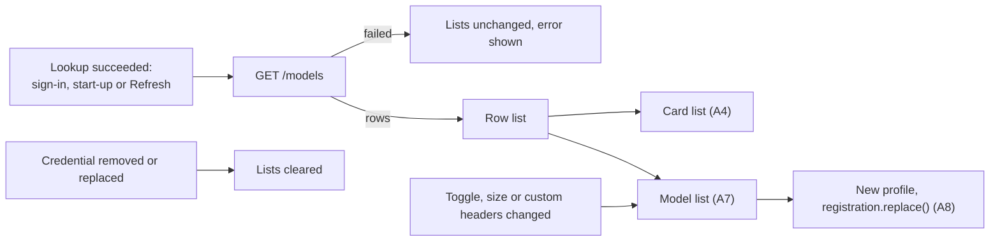
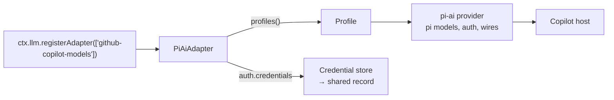

# Models

The Models component fetches the model list of the signed-in GitHub Copilot account (`GET /models`), shows every model on the Card with an on/off toggle, and serves the switched-on models to DSH through the plugin's own route, `github-copilot-models`. It takes its input from the Login component ([login.md](login.md)).

This document is the implementation specification of the Models component. The facts it depends on from Login, DSH, pi-ai and the Copilot API are stated here, so no other document is needed to implement it.

This document has three parts, split by who controls the behaviour:

| Part | Controlled by | Used by the plugin | Content |
|---|---|---|---|
| [A. What the plugin owns](#a-what-the-plugin-owns) | the plugin | yes | The design. |
| [B. What the plugin relies on](#b-what-the-plugin-relies-on) | DSH, pi-ai, GitHub | yes | Behaviour the plugin calls or depends on. Re-check it when a version changes. |
| [C. Background only](#c-background-only) | DSH, pi-ai, GitHub | no | Facts recorded for reference. Nothing in the plugin depends on them. |
| [Open points](#open-points) | | | Decisions and open items, items not verified, and checks that need a real request. |

Sections are numbered by part (A1, B1, C1). Questions still open, and checks that need a real request, are listed under [Open points](#open-points).

## Terms

| Term | Meaning | See |
|---|---|---|
| Card | The plugin's settings card in the DSH web UI. It never receives a token. Its location and layout: [ui.md](ui.md). | A11 |
| Host | The plugin's server-side code, running inside DSH. | |
| Copilot host | The origin of the Copilot API for the account, for example `https://api.business.githubcopilot.com`. Provided by Login. | A1 |
| Shared record | The DSH credential record of DSH's built-in route `github-copilot`, named by DSH. Written by the sign-in, read by the plugin and by DSH's built-in route. | A1 |
| Route | The plugin's route id in DSH, `github-copilot-models`. Every request to the plugin's models carries it as `provider`. | A8 |
| Row | One element of `data` in the `/models` reply. | B3 |
| Wire | pi-ai's request protocol: `openai-responses`, `anthropic-messages` or `openai-completions`. | A7 |
| Usable endpoint | `/responses`, `/v1/messages` or `/chat/completions` in a row's `supported_endpoints`. | A7 |
| Reason code | A fixed code that marks a row the plugin cannot serve. | A10 |
| Row list | All rows of the last successful reply, as received, with the Copilot host and login method of that fetch. | A3 |
| Tier | One price tier in `billing.token_prices`: `default` or `long_context`. | B3 |
| Two-tier row | A row whose `default` and `long_context` tiers both give `max_prompt_tokens`. Its Context row on the Card has a Long button beside Default. | A4 |
| Copilot's values | The context and output sizes of a row when the user stores none: Copilot's context and `max_output_tokens`. | A4 |
| pi model | An object of pi-ai's `Model` type, built from one row. | A7 |
| Model list | The pi models of the switched-on rows. | A3, A7 |
| Default view | The `/models` reply without the header `X-GitHub-Api-Version`. | B4 |
| Long view | The `/models` reply with `X-GitHub-Api-Version`. | B4 |

---

## A. What the plugin owns

### A1. Input from Login

Models never signs in. It uses Login's output and the shared record.

**Login output:**

| Field | Value | Use in Models |
|---|---|---|
| `method` | `'browser'` or `'pat'` | Selects the integration id |
| `host` | The Copilot host: an https origin with no path, validated by Login | Origin of the `/models` request and of every model request |
| `account` | The GitHub login name | Not used |

Login notifies Models inside the Host of two events, and Models acts on them as described in A3:
- a host lookup succeeded, at sign-in, at start-up or at Refresh;
- the stored credential was removed or replaced: by a sign-in of either method, a sign-out, or a change outside the plugin.

A failed lookup for an unchanged credential is not an event for Models.

**Shared record.** The record DSH's `llm-pi-ai` keeps for its built-in route `github-copilot`. The plugin asks DSH for its key with `recordKeyFor('github-copilot')` from `@deepseek-ai/dsh-llm-pi-ai` (`RECORD_KEY` in `src/host/ports.ts`) instead of writing it out, so both keep sharing one login if DSH ever names its records differently (login.md B3). Decided on 2026-11-08.

| Method | Record | Token |
|---|---|---|
| browser | `{ kind: 'grant', payload: { type: 'oauth', refresh, access, expires, enterpriseUrl?, availableModelIds? } }` | `payload.access`, the Copilot token. pi-ai refreshes it when it expires within 5 minutes and rewrites the record. |
| pat | `{ kind: 'api-key', key }` | `key`, the PAT |

Models obtains the token only through pi-ai (A2, A8), so that an expiring Copilot token is refreshed first. The token is never stored, logged, or sent to the Card.

**Integration id.** Each login method sends its own `Copilot-Integration-Id`. Both values are the constant `INTEGRATION_ID` in `src/shared/api.ts`, so the Host and the Card read the same values: the Host sends them, and the Card shows the header each method sends, under Browser and under Personal access token ("Requests to Copilot send the header `Copilot-Integration-Id: vscode-chat`.", locale key `integrationHint`, in all 8 languages).

| Method | `Copilot-Integration-Id` | Why |
|---|---|---|
| browser | `vscode-chat` | The value pi-ai sends |
| pat | `copilot-developer-cli` | Copilot requires it with a PAT (B2) |

### A2. The `/models` request

```
GET <host>/models
Accept: application/json
Authorization: Bearer <token>
Copilot-Integration-Id: <integration id>
<custom headers (A6); by default X-GitHub-Api-Version: 2026-08-01>
```

- **Token.** Obtained from a pi-ai collection that holds the provider from A8:

  ```ts
  const authModels = createModels({ credentials: store, authContext })   // store, authContext: A8
  authModels.setProvider(piProvider)                                      // piProvider: A8
  const token = (await authModels.getAuth('github-copilot-models'))?.auth.apiKey
  ```

  No result means there is no credential. No request is sent, and Models clears its lists (A3).
- **Token refresh.** For a browser login, `getAuth` first refreshes a Copilot token that expires within 5 minutes. The refresh sends two requests of pi-ai's own, the token exchange and its own `/models` call, and rewrites the record (B6, B7). A PAT is used as stored.
- **Version header.** `X-GitHub-Api-Version: 2026-08-01` selects the long view (B4). It is sent as the default entry of the custom headers (A6), so the user can change or remove it. `2026-08-01` is the one constant the plugin sets: pi-ai does not export its own value (B7).
- No editor headers are sent.
- Custom headers are applied last and override headers of the same name, compared without case.
- The request uses the global `fetch` with `redirect: 'error'`, a 10-second timeout, and no retry.
- The host is used as Login provides it. Models applies no further host check.

**Reply.** A valid reply is JSON with a `data` array of at least one row. Any other reply is a failed fetch (A3, A10). Rows are kept as received.

### A3. Fetch times and state

Models fetches `/models` only after one of Login's host lookups succeeds (A1):
- after a successful sign-in, by either method;
- at start-up, after Login's start-up lookup;
- when the user presses Refresh. Refresh runs Login's host lookup first, then the fetch. When the lookup fails, the fetch is skipped.

No other event or timer sends the request. A change to a toggle, a size or the custom headers sends no request: it rebuilds the model list and republishes it (A8).

Only one fetch runs at a time. A trigger that arrives during a fetch starts one new fetch when the running one ends; further triggers before then share it. The result of an older fetch never replaces the result of a newer one, and the result of a fetch for a credential that has since been removed or replaced is dropped.

**State.** Kept in Host memory only. No model data is written to disk or to `Config`.

| State | Content |
|---|---|
| Row list | All rows of the last successful reply, as received, with the Copilot host and the login method that fetch used |
| Model list | The pi models built from the row list and the stored choices (A7) |
| Last fetch | Time, URL, HTTP status, request ids and error of the last fetch |

Model requests use the host and method of the row list, so the model list keeps working while Login shows a failed lookup.

**Transitions:**

| Event | Row list and model list |
|---|---|
| Successful fetch | Replaced |
| Failed fetch | Unchanged. The error is shown on the Card. |
| Failed host lookup on Refresh | Unchanged, and no fetch is sent. The Card shows the lookup error (login.md A8). |
| The stored credential replaced: a sign-in by either method, or a change outside the plugin (login.md A2) | Cleared. After a sign-in, the fetch that follows the lookup fills them; when the lookup or the fetch fails, they stay empty. |
| Sign-out, or the record removed outside the plugin | Cleared |
| Failed or cancelled sign-in that leaves the record unchanged | Unchanged |
| No credential when a fetch starts | Cleared. No request is sent. |

After a DSH restart both lists are empty until the first successful fetch. Until then a request for one of the plugin's models fails with `UNKNOWN_MODEL` (B6).



### A4. Model list on the Card

The Card shows one block per row of the row list, as received, without grouping or translation: the rows that can be served first, then the locked rows (Order, below). The blocks are stacked, because the panel is too narrow for a table (ui.md U3).

```
 Model name  [Policy: <state>]                                  [switch]
 model-id · wire
 GPT-5.6 Terra has a planned deprecation date of 2026-11-16.          ← info message
 Context  [ 400000 ] [Default] [Long]
 Output   [ 128000 ] [Default]
          [Save]  <why it cannot be saved, or "Saved.">
 ⌄ Prices                                                             ← fold, open at first
     AI credits per 1000000 tokens
                Prompt up to   Input   Output   Cache read   Cache write
     Default          272000     200     1200           20           250
     Long             922000     400     1800           40           500
 › Details                                                            ← fold, closed at first

 ⌄ 19 models cannot be served                                         ← fold of the locked rows; closed at first, shown open here
     Model name                                         Cannot be served
     model-id
     NO_ENDPOINT: no endpoint this plugin can call
     Prices  All prices are 0
     › Details
```

| Part | Content |
|---|---|
| Model name | `name`, or `id` when the row has no `name` |
| Switch | Show in picker: the toggle (rules below). A locked row shows "Cannot be served" instead. |
| Policy | A "Policy: `<state>`" badge, amber, with `policy.state` as received, only when the row has a `policy` whose state is not `enabled`. In the observed replies (C1) every row with a policy had `enabled`, so no badge showed; an `enabled` policy and its `terms` stay in Details. Decided 2026-11-07; before, every state showed. |
| Info | Each of the row's `info_messages` that has a `message`, as received, one line per message; amber for the code `model_pending_deprecation`, for example GPT-5.6 Terra on 2026-11-03: "GPT-5.6 Terra has a planned deprecation date of 2026-11-16." Decided 2026-11-07. |
| Context and output | The sizes (rules below), on rows that can be served |
| Prices | The prices (rules below), in a fold titled Prices, open at first |
| Details | All fields of the row, as received, in a fold titled Details, closed at first |

The folds were decided on 2026-11-07; before, the prices stood in the label column beside the sizes, and Details was a link.

**Sizes.** Every limit comes from the reply. Nothing is hard-coded, and the plugin does not copy DSH's compaction formula (B5). Decided on 2026-11-05: a Context row and an Output row on every row that can be served, each a field with buttons that fill it in, and one Save. They replace radio buttons for Default and Long, which offered no size in between and no other output size. A first version of the same day, where a preset saved at once, was dropped: one Save for both fields is clearer, and a refused size showed far from the fields.
- **Fields.** Each field shows the stored value, or Copilot's value when none is stored, as plain digits (`328000`):
  - **Copilot's context:** the default tier's `max_prompt_tokens` plus `max_output_tokens`, never above `max_context_window_tokens`; `max_context_window_tokens` when the default tier gives no `max_prompt_tokens`. On a two-tier row this is the Default size. On every other row of the observed long-view reply (B3) it equals `max_context_window_tokens`.
  - **Copilot's output:** `max_output_tokens`.
  - **Digits only.** A field takes the digits 0–9 and nothing else: no separators, signs or exponents. Full-width digits (０–９, typed by Chinese and Japanese input methods) count as digits, and spaces around the digits are ignored; when you leave the field, such a value shows as it will be saved, "１２８０００" as "128000". Anything else is refused as you type with "use digits only (0–9), without separators", and stays as typed. The reason: `,` and `.` mean thousands in some languages and decimals in others, so a German "128.000" (128 thousand) was read as 128 and could be saved. Decided on 2026-11-08, as was keeping full-width digits and showing them as 0–9 once you leave the field.
- **Buttons.** Each field has a **Default** button, which puts Copilot's value in the field. On a two-tier row, Context also has **Long**, which puts the Long size in it: the long tier's `max_prompt_tokens` plus `max_output_tokens`, never above `max_context_window_tokens`. VS Code's Copilot Chat derives its two sizes from the same fields. A button only fills its field; nothing is stored until Save. A button shows as pressed while its field holds its value, an empty field counting as Copilot's value; with any other value, none is pressed.
- **Save.** Save stores both fields together. A field that is empty or holds Copilot's value is not stored, so that size follows Copilot's value, also after a later reply changes it. When neither field is stored, the entry is removed. Save is disabled until the fields differ from what is stored, and while a value is not digits only, is not a positive integer, or the output is not below the context: the Card checks these as you type. Long with a smaller output is refused like any other pair: for Claude Sonnet 5.5, Long with output 32,000 gives 1,000,000 − 32,000 = 968,000, above its prompt limit of 936,000. A stored Long size is a plain number: a later reply that changes the Long size does not change it, and it is checked like any stored size.
- **Checks.** A typed value must be a positive integer, and the pair in use, where an empty field counts as Copilot's value, must pass these checks:
  - context ≤ `max_context_window_tokens`;
  - output ≤ `max_output_tokens`;
  - output < context;
  - context − output ≤ the row's prompt limit: `billing.token_prices.long_context.max_prompt_tokens` when present, otherwise `billing.token_prices.default.max_prompt_tokens`. A two-tier row therefore takes any size up to Long, and a prompt above the default tier's limit is billed at the long tier's prices (B3).

  The checks use only values from the reply; a value the reply does not give is not checked. A refused value is not stored, and the Card shows the check that failed beside Save.
- Stored sizes are checked again each time the model list is built (A7). A stored size that no longer passes is not used: Copilot's values apply, and the Card shows the check that failed beside Save.
- The context size changes nothing on the wire: only the window DSH sees, and so when DSH compacts. The output size is also a request's output cap when DSH sets none (B5).

**Prices.** When the row has `billing`, the Card shows the prices as a small table in the Prices fold, captioned "AI credits per `<batch_size>` tokens" (B3). One row per tier, the default tier first, named **Default** and **Long** like the size buttons, or by its name as received for any other tier. The columns are "Prompt up to" (the tier's `max_prompt_tokens`), Input, Output, Cache read, Cache write and Cache write 1h (`input_price`, `output_price`, `cache_read_price`, `cache_write_price`, `cache_write_1h_price`), each only when some tier gives it; a tier without a value leaves its cell empty. Prices keep their value, written as plain numbers in every language: no thousands separators and a dot for decimals (`2000`, `0.25`; ui.md U4). Rows that cannot be served keep their prices. When every price of the row is `0` (such rows have `batch_size` `0`, C1), there is nothing to fold: the Card shows the title and "All prices are 0" on one line. Without `billing`, or without any price in it, that line says "Price not reported by Copilot". Prices are shown only; they do not reach DSH (A7). The table replaced one text line per tier, decided on 2026-11-07.

**Toggle state**, decided in this order:
1. `locked` when the row has a reason code (A10). The Card shows the code.
2. `off` when the model would have no context size: Copilot's context is missing, because the reply gives neither `max_context_window_tokens` nor the default tier's `max_prompt_tokens`, and no usable context size is stored. The toggle stays off until the user enters one.
3. The stored `modelVisibility[id]`, when present.
4. `on` when `model_picker_enabled` is `true`, otherwise `off`.

**Order.** Rows without a reason code first, then locked rows. Within each group, the order of the reply. The locked rows sit in one fold after the others, titled with their count ("19 models cannot be served"; "1 model cannot be served"), closed at first, and open at first when no row can be served. Decided on 2026-11-07, to shorten the list: in the observed replies most rows were locked (C1).

**Rows no longer returned.** After a successful fetch, an id with a stored choice (A5) that is not in the row list is shown as "no longer returned", with its stored choices. They are kept until the user clears them. While the row list is empty, no id is shown as no longer returned.

### A5. Stored choices

The user's choices are stored in the plugin's `Config` as volatile fields. Model data is never stored.

| Field | Type | Meaning |
|---|---|---|
| `modelVisibility` | `{ [modelId]: boolean }` | Toggle state. No entry: the default from A4. |
| `modelLimits` | `{ [modelId]: { context?: number, output?: number } }` | Sizes (A4), positive integers. A missing field means Copilot's value. A preset is stored as its numbers (A4). |
| `customHeaders` | `{ [name]: string }` | Request headers (A6). Default: `{ 'X-GitHub-Api-Version': '2026-08-01' }` |

Schema, including Login's `domain` field:

```ts
import Schema from '@deepseek-ai/schemastery'

export const Config = Schema.object({
  domain: Schema.string().default('').volatile(),                // Login
  modelVisibility: Schema.dict(Schema.boolean()).default({}).volatile(),
  modelLimits: Schema.dict(Schema.object({
    context: Schema.natural(),
    output: Schema.natural(),
  })).default({}).volatile(),
  customHeaders: Schema.dict(Schema.string()).default({ 'X-GitHub-Api-Version': '2026-08-01' }).volatile(),
})
```

- `Schema.natural()` accepts `0`. The Host refuses `0` before writing.
- A stored empty `customHeaders` stays empty, so a removed version header stays removed.
- **Read.** With `.get()`, once per operation.
- **Write.** By the Host only, with `ctx.settings.mutate(ns, ops)`, where `ns` is `ctx.fiber.entry?.options.id`. `modelVisibility` and `modelLimits` are written one model entry per change, with `{ op: 'set', path: [field, id], value }` or `{ op: 'unset', path: [field, id] }`. `customHeaders` is written as one value, because the Card edits it as one list.
- **React.** On `loader/volatile-update`, rebuild the model list (A7) and republish it (A8).

### A6. Custom request headers

Below the model list the Card shows a list of header name and value pairs, with Add and Remove. The list is stored in `customHeaders`. It starts with one entry, `X-GitHub-Api-Version: 2026-08-01`, which selects the long view (A2, B4). The user can change or remove it like any other entry.

- **Validation.** Each pair must be accepted by `new Headers([[name, value]])`, and a name may appear once, compared without case. Otherwise the Card shows the error and nothing is saved. Names are not restricted otherwise.
- **Effect.** The headers are applied last on the `/models` request and on model requests, so they override the plugin's own headers, including `Authorization` and `Copilot-Integration-Id`. On model requests, DSH replaces `User-Agent` with its own (B6).
- **Timing.** A change applies to the next fetch and the next model request.
- **Notice.** Next to the list the Card states that the values are stored as plain configuration and must not contain secrets, that these headers override the plugin's own, and that a change to the `/models` reply appears after Refresh.

### A7. From row to model entry

A row becomes a pi model when its toggle is `on`. Missing fields are never replaced by guessed values.

The model list does the job of pi-ai's bundled Copilot list (`providers/data/github-copilot.json`, fixed at each pi-ai release): one pi model per row, with the same fields a bundled entry carries (`id`, `name`, `api`, `input`, `contextWindow`, `maxTokens`, `reasoning`, `thinkingLevelMap`, `compat`), built from the live reply instead of a file. Sending the requests, streaming, and refreshing the Copilot token stay pi-ai's code (A8).

**Wire.** The first match in `supported_endpoints`, in this order:

| Order | Endpoint | `api` |
|---|---|---|
| 1 | `/responses` | `openai-responses` |
| 2 | `/v1/messages` | `anthropic-messages` |
| 3 | `/chat/completions` | `openai-completions` |

`ws:/responses` and any other value are ignored.

- **The `api` names are pi-ai's** (`KnownApi` in pi-ai's `types.d.ts`). Each names one of pi-ai's request implementations, and pi-ai runs the one registered under a model's `api` (A8). The names must be exactly these: pi-ai picks a model's `compat` options by them, DSH's `dsh-llm-pi-ai` checks them for tool updates (`dsh-llm-pi-ai/lib/index.js:790-792`), and the plugin checks `anthropic-messages` for its auth headers (A8).
- **pi-ai has no rule of its own.** It never reads `supported_endpoints` (*read in code*): each bundled model's `api` is fixed in its file. A model Copilot adds after a pi-ai release has no wire in pi-ai until the next release (C3).
- **Why a fixed order, not Copilot's.** The array order is undocumented and not consistent: `claude-opus-5.5` lists `/v1/messages` first and `claude-haiku-4.5` lists `/chat/completions` first (C1), so following it would put one family on two wires. It could also change between fetches. The fixed order matches pi-ai's bundled list, where every Claude model is `anthropic-messages`, every GPT, Grok and MAI model `openai-responses`, and only Gemini and Kimi `openai-completions`: for every usable row of a Business account's reply, the plugin chose the same `api` as the bundled list (*observed*).
- **Effect on errors.** A wire decides how Copilot reports a blocked reply: `stop_reason: "refusal"` on `/v1/messages` (pi-ai's message "The model refused to complete the request", `anthropic-messages.js` `mapStopReason`; DSH code `PI_AI_ERROR`), `incomplete_details.reason` on `/responses` ("Response incomplete: `<reason>`"), `finish_reason: "content_filter"` on `/chat/completions` ("Provider finish_reason: content_filter") (*read in code*). None is retried.

**Limits:**
- `contextWindow` is the stored context size, otherwise Copilot's context (A4); `maxTokens` is the stored output size, otherwise `max_output_tokens`. A stored pair that fails the checks in A4 is not used: both sizes are Copilot's values.
- A value from the reply that is not a positive integer counts as missing.
- `capabilities.limits.max_prompt_tokens` is not used (B5).

**Effort levels.** pi-ai's levels are `off`, `minimal`, `low`, `medium`, `high`, `xhigh` and `max`.
- `efforts`: the values of `capabilities.supports.reasoning_effort` that are pi-ai levels other than `off`. Copilot's `none` is not a pi-ai level and is not used. On the `anthropic-messages` wire, `efforts` is empty unless `capabilities.supports.adaptive_thinking` is `true`.
- `reasoning`: `efforts.length > 0`.
- `thinkingLevelMap`: present only when `reasoning` is `true`. Every pi-ai level is set explicitly: a level in `efforts` maps to itself, and any other level, `off` included, maps to `null`.
- No default effort is set.

DSH derives the picker's effort choices from these fields (B6). The picker offers no Off, because `off` maps to `null`. DSH sends no effort for "Provider default", and with `off` mapped to `null` pi-ai then sends no reasoning field on any wire, so Copilot's own default applies. Mapping `off` to `'none'` would make the Responses wire send `reasoning.effort: 'none'` for "Provider default" (B6), which turns reasoning off.

**Compat** (`compatFor`):

| Wire | `compat` |
|---|---|
| `anthropic-messages` | `{ forceAdaptiveThinking: <adaptive_thinking === true>, supportsEagerToolInputStreaming: false }` |
| `openai-completions` | `{ supportsStore: false, supportsDeveloperRole: false, supportsStrictMode: false, supportsReasoningEffort: efforts.length > 0, thinkingFormat: 'openai' }` |
| `openai-responses` | `{ supportsStrictMode: false }` |

**pi model:**

```ts
{
  id: row.id,
  name: row.name,                                              // row.id when the row has no name
  api: wire,
  provider: 'github-copilot-models',
  baseUrl: host,                                               // the row list's host (A3)
  type: 'chat',
  input: row.capabilities.supports.vision === true ? ['text', 'image'] : ['text'],
  reasoning,
  thinkingLevelMap,                                            // omitted when reasoning is false
  contextWindow,
  maxTokens,
  headers: staticHeaders,                                      // githubCopilotProvider().getModels()[0].headers
  cost: { input: 0, output: 0, cacheRead: 0, cacheWrite: 0 },
  compat: compatFor(wire, row),
}
```

`cost` stays `0`: the reply's prices are AI credits, a unit the reply itself does not name (B3), so they are shown on the Card (A4) and not converted.

### A8. Adapter and route

The route id is `github-copilot-models`. The adapter is an instance of `PiAiAdapter` from `@deepseek-ai/dsh-llm-pi-ai`. pi-ai sends the requests. The plugin supplies a credential store, a pi-ai provider and a profile. The plugin implements no wire itself: the provider maps each of the three `api` names to pi-ai's own implementation (`openAIResponsesApi()`, `anthropicMessagesApi()`, `openAICompletionsApi()`), the same three lines as pi-ai's `githubCopilotProvider()`, and only the model list (A7) is the plugin's.



**1. Credential store.** pi-ai reads the credential by route id. DSH's own store maps a route id to `llm-pi-ai/<route id>` (B6), which does not exist for this route. The plugin therefore implements pi-ai's `CredentialStore` over the shared record:

| Method | Behaviour |
|---|---|
| `read(id)` | Rejects any id other than `github-copilot-models`. Reads the shared record with `ctx.credentials.readRecord(key)` and converts it: `kind: 'grant'` → `payload`; `kind: 'api-key'` → `{ type: 'api_key', key }`. |
| `list()` | `[{ providerId: 'github-copilot-models', type: 'oauth' \| 'api_key' }]` when the record exists, otherwise `[]`. No secret values. |
| `modify(id, mutate)` | `ctx.credentials.modifyRecord(key, …)`, converting in both directions: `type: 'api_key'` → `{ kind: 'api-key', key }`; any other credential → `{ kind: 'grant', payload }`. pi-ai uses it to store a refreshed Copilot token. Members whose value is `undefined` are left out of the payload, as DSH's own store does: the credentials service refuses them, and a refreshed github.com credential carries `enterpriseUrl: undefined`. |
| `delete(id)` | Not used by Models. |

The auth context is `{ env: async () => undefined, fileExists: async () => false }`, so pi-ai finds no ambient credentials.

**2. pi-ai provider:**

```ts
const native = githubCopilotProvider()
const base = createProvider({
  id: 'github-copilot-models',
  name: 'GitHub Copilot (plugin)',
  baseUrl: host,                                                 // the row list's host (A3)
  auth: {
    oauth: {
      ...native.auth.oauth,
      login: async () => { throw new Error('Sign in on the plugin card') },
      toAuth: async (credential) => ({ ...(await native.auth.oauth.toAuth(credential)), baseUrl: host }),
    },
    apiKey: native.auth.apiKey,
  },
  models: piModels,
  api: {
    'openai-responses': openAIResponsesApi(),
    'anthropic-messages': anthropicMessagesApi(),
    'openai-completions': openAICompletionsApi(),
  },
})
```

- `oauth` is pi-ai's Copilot OAuth method. Its token refresh is used unchanged. `toAuth` returns the row list's host, because pi-ai otherwise sends requests to the host named in the token (B6). `login` is disabled, because Models never signs in.
- `apiKey` is pi-ai's Copilot API-key method. It returns the stored PAT. Its environment fallback finds nothing with the auth context above (B6).
- For a PAT, no host comes from auth, so `model.baseUrl`, the row list's host, applies.

**3. Per-request headers.** pi-ai adds the Copilot request headers only for the provider id `github-copilot`, and on the `anthropic-messages` wire it sends the token as `x-api-key` for any other provider id (B6). The plugin wraps `stream` and `streamSimple`:

```ts
const withCopilotHeaders = (fn) => (model, context, options = {}) => fn(model, context, {
  ...options,
  headers: {
    ...buildCopilotDynamicHeaders({ messages: context.messages, hasImages: hasCopilotVisionInput(context.messages) }),
    ...(model.api === 'anthropic-messages' ? { Authorization: `Bearer ${options.apiKey}`, 'x-api-key': null } : {}),
    ...options.headers,
  },
})

const piProvider = {
  ...base,
  getModels: () => piModels,
  getAllModels: () => piModels,
  stream: withCopilotHeaders(base.stream),
  streamSimple: withCopilotHeaders(base.streamSimple),
}
```

Headers of a model request, in merge order (a later entry overrides an earlier one):

| Header | Value | Source |
|---|---|---|
| `User-Agent`, `Editor-Version`, `Editor-Plugin-Version`, `Copilot-Integration-Id` | pi-ai's static block | `model.headers` (A7) |
| `Authorization` | `Bearer <token>` | pi-ai; on `anthropic-messages`, the wrap |
| `X-Initiator`, `Openai-Intent`, `Copilot-Vision-Request` | Per request | The wrap |
| `Copilot-Integration-Id` | The integration id of the row list's login method (A1, A3) | Profile `headers` |
| Custom headers, by default `X-GitHub-Api-Version: 2026-08-01` | A6 | Profile `headers` |
| `User-Agent` | `deepseek-harness/<version> (+url)` | DSH |

**4. Profile.** `PiAiAdapter` reads `profiles()` once per operation. The plugin returns a `Map` with one entry:

| Field | Value |
|---|---|
| `provider` | `'github-copilot-models'` |
| `displayName` | `'GitHub Copilot (plugin)'`, because DSH's built-in route is named "GitHub Copilot" |
| `piProvider` | Step 3 |
| `headers` | `{ 'Copilot-Integration-Id': <integration id>, ...customHeaders }` |
| `configuredMaxTokens` | `new Map(piModels.map((m) => [m.id, m.maxTokens]))`. DSH reports it as the model's `defaultMaxTokens`, which compaction reserves for output (B5). |
| `modelErrors` | `new Map()` |
| `retryPolicy` | `resolveRetryPolicy(undefined, 'github-copilot-models')` |
| `streamIdleTimeoutMs` | `300000` |
| `maxRequestImageBytes` | `20 * 1024 * 1024` |
| `requestImagePixelBudget` | `2048 * 2048` |
| `requestImageMaxBytes` | `1024 * 1024` |
| `maxRequestImages` | `50`, DSH's default; required since DSH 0.2.2-rc.1 (open point 14) |
| `imageOffloadCountQuantum` | `10`, DSH's default; required since DSH 0.2.2-rc.1 |

**5. Adapter and registration**, inside `ctx.effect`:

```ts
const adapter = new LabelledPiAiAdapter({   // PiAiAdapter, plus the picker labels (A9)
  profiles: () => profiles,                  // the Map from step 4
  resolveApiKey: async () => undefined,      // authentication comes from the credential store
  auth: { credentials: store, authContext },
  resolveAttachments: () => ctx.get('attachments'),
  resolveImageAccess: (attachments, ref) => resolveImageAttachmentAccess(
    attachments, (hostPath) => ctx.get('fs')?.processPathFromHostPath(hostPath), ref),
}, () => badges)                             // model id → picker label, rebuilt with the profiles
const registration = ctx.llm.registerAdapter(['github-copilot-models'], adapter)
```

- **Republish.** On every change of the model list or of the profile headers, the plugin builds a new profile `Map` and the picker labels, and calls `registration.replace(['github-copilot-models'])`. `PiAiAdapter` uses the new models when `profiles()` returns a different `Map` object (B6).
- **Empty list.** When signed out or before the first fetch, the route stays registered with an empty model list, so DSH lists no models for it.

### A9. Model picker

- DSH's model picker lists the switched-on models under the profile's display name, with the effort choices derived from A7.
- The context size is set on the Card. The picker has no control for it (B8).
- **Label.** Each model carries a label in the picker, beside its name (B8): its context size as DSH uses it, written compactly (`328K`, `1M`, `1.05M`), in the neutral tone; or "Deprecating" in the warning tone, in DSH's eight languages (Chinese "即将弃用", Japanese "廃止予定", German "Auslaufend", and so on; ui.md U4), while the row has the info message `model_pending_deprecation` (A4). The size follows the Card: a stored size or Long changes the label at the next republish, with no restart and no request. The date of a retirement stays on the Card, because Copilot gives it only inside the message text.
- **How.** `PiAiAdapter` lists no label, so the plugin's adapter is a subclass, `LabelledPiAiAdapter`, whose `listModels` adds the label of each model id to `PiAiAdapter`'s list. DSH's model service passes it on (`dsh-llm/lib/index.js:2086-2105`; contract tests, B9).
- Decided on 2026-11-07 (open point 11). On 2026-11-03 the picker got no label, because its only place then was the `conversation.input.model.label` slot, which held DSH's own model label.

### A10. Errors

Errors are recognised by their source (HTTP status, DSH `LlmError` code), never by message text.

| Situation | Behaviour | Message to the user |
|---|---|---|
| `/models` fails, times out, is not JSON, has no `data`, or has no rows | Lists unchanged (A3) | Could not refresh models: URL, HTTP status, and `x-github-request-id` and `x-copilot-service-request-id` when present |
| Refresh's host lookup fails | Lists unchanged. No fetch (A3). | Login's lookup error (login.md A8) |
| No credential for `/models` | Lists cleared (A3). No request sent. | Not signed in |
| 401, 403 or 421 from the Copilot host | Lists unchanged. The cause may be a wrong host rather than a bad credential (B2). | HTTP status and the host used |
| 400 "Personal Access Tokens are not supported for this endpoint" | Lists unchanged. Occurs only when a custom header replaces `Copilot-Integration-Id`. | Copilot's message |
| 429 | Lists unchanged. No retry. | Rate limited, with `Retry-After` when present |
| Copilot token refresh fails | pi-ai throws when `getAuth` or a model request needs the token | "Sign in again:" and pi-ai's message |
| Model request fails | pi-ai and DSH report it as the stream's `finish` error | Shown by DSH's chat |
| A size refused by the checks (A4) | Not saved | The check that failed |
| A stored size that no longer passes the checks (A4) | Copilot's values are used | The check that failed, next to the fields |
| Custom header refused by `Headers`, or a name given twice | Not saved | The error from `Headers`, or the repeated name |
| Route id already registered | `registerAdapter` throws `DUPLICATE_ADAPTER` | Route `github-copilot-models` is already in use |

**Reason codes**, the first that applies, in this order:

| Code | Row |
|---|---|
| `NO_ID` | `id` is missing or not a non-empty string |
| `NOT_CHAT` | `capabilities.type` is not `chat` |
| `NO_ENDPOINT` | No usable endpoint in `supported_endpoints` |
| `NO_LIMITS` | `max_output_tokens` is missing or not a positive integer |
| `DUPLICATE_ID` | Its `id` already appeared earlier in the same reply |

### A11. Card ↔ Host

Decided 2026-11-03. The Card calls the Host through exact routes under `/api/github-copilot-models/`, registered with `ctx.connection.fetch.register`, beside Login's routes (login.md A10). The types are in `src/shared/api.ts`. No route returns a token. Of the routes below, only Refresh sends a request; Login's sign-in routes also run the fetch after their lookup (A3).

| Button or view on the Card | Route | Reply |
|---|---|---|
| The card opens, or a fetch runs | `GET models` | The models state: the rows in A4 order, each with its toggle state, reason code, wire, sizes (Copilot's values, the stored sizes and their check result, and on a two-tier row the Long size), prices, and the row as received; the "no longer returned" ids with their stored choices; the custom headers; whether a fetch runs; the last fetch (A3) |
| Refresh | `POST refresh` (login.md A10) | Runs Login's host lookup and, when it succeeds, the fetch (A3). The reply carries the login state and the models state. |
| Show in picker, or clear a stored toggle | `POST setVisibility` `{ id, on }` or `{ id, clear: true }` | Writes `modelVisibility`. The models state |
| Save the context and output, or clear the sizes of a model no longer returned | `POST setLimits` `{ id, context?, output? }` or `{ id, clear: true }` | Checks the sizes (A4), then writes `modelLimits`. The models state, or the check that failed |
| Save the custom headers | `POST setHeaders` `{ headers: { [name]: value } }` | Validates the list (A6), then writes `customHeaders`. The models state, or the error |

- Every `POST` reply, Login's included, carries the models state, and the login state says whether a fetch runs. The Card therefore re-reads `models` only while a fetch runs.
- Save leaves out of `setLimits` a field that is empty or holds Copilot's value (A4). With both left out, it sends `{ id, clear: true }`, which is not checked, so going back to Copilot's values is never refused. Default and Long only fill a field and send nothing.

### A12. Tests

Offline, with fakes in place of Copilot. Fixtures are written by hand from the schema in B3. Tests of DSH and pi-ai behaviour are in B9.

Unit tests, over fakes:
- `/models` request: URL, headers, header order, the version header from the default custom headers and none once the user removes it, custom headers last and compared without case, `redirect: 'error'`, 10-second timeout.
- Fetch times: sign-in, start-up after the host lookup, Refresh after a successful lookup. No request after a failed lookup, on a toggle, size or header change, or on any other event. Concurrent triggers yield the newer result; a fetch for a replaced credential is dropped.
- State transitions in A3, including fail-open, keeping the lists on a failed lookup, and clearing them on a replaced credential and on sign-out.
- Only `modelVisibility`, `modelLimits` and `customHeaders` are written, only on a user action, and one model entry per `settings.mutate` call for the first two.
- Toggle state for each case in A4.
- Sizes: Copilot's context with and without the default tier's `max_prompt_tokens`, never above the window; the Long size of a two-tier row, never above the window; each check refused on its own, with the long tier's prompt limit when the row has one; `0` and non-integers refused; stored sizes checked again when the reply changes.
- Prices per tier as received; "All prices are 0" when every price is `0`; "Price not reported by Copilot" without `billing`; the price table's columns, only those some tier gives, and its tier names.
- Head: `policy.state` passed as received, every state; `info_messages` passed as received, skipping entries without a text.
- Picker label (A9): the context size in use, compact (`328K`, `1M`, `1.05M`), or "Deprecating" with `model_pending_deprecation`; every pi model spec carries its label.
- Wire selection for each combination of endpoints; `ws:/responses` ignored; reason codes.
- Every pi model field in A7, including `thinkingLevelMap` with `off` always `null`, `none` ignored, and `efforts` on the `anthropic-messages` wire with and without `adaptive_thinking`.
- Credential store: both record kinds in both directions; `undefined` members left out; another id rejected.
- Custom headers: refused pairs, a repeated name, the default version header, an empty list kept empty.
- Republish: a toggle, size or header change builds a new profile `Map` and calls `registration.replace()`.
- "No longer returned" ids keep their stored choice.

With the installed pi-ai and DSH and `fetch` replaced, in the contract suite:
- Token: a grant that expires within 5 minutes is refreshed first; a PAT record yields the PAT; no record sends no request.
- Adapter: `listModels` and `resolveModel` report the window, `defaultMaxTokens` and effort choices from A7, with no Off; the empty list yields no models.
- Model requests on all three wires: `Authorization: Bearer` and no `x-api-key`; the static block; `X-Initiator` and `Openai-Intent`; the integration id; custom headers last, with the version header by default; the row list's host, not the token's host; no reasoning field without an effort.

---

## B. What the plugin relies on

Behaviour of DSH 0.2.2-rc.1, the pi-ai 1.5.0 it installs, and the Copilot API. Re-read against these versions on 2026-11-07; first written against DSH 0.2.1-rc.5 and pi-ai 1.4.0. Re-check this part when a version changes. File references are to the installed packages. Evidence is marked as *observed* (a real Copilot request with one Business account, between late October and early November 2026, C1), *verified offline* (run against a local HTTP server with a fake token), *read in code*, or *reported* (a third party, not verified).

### B1. Dependencies

The adapter imports DSH's own copies of `@deepseek-ai/dsh-llm-pi-ai`, `@deepseek-ai/dsh-llm` and `@earendil-works/pi-ai`, not second copies: `PiAiAdapter` extends `dsh-llm`'s `LlmAdapter`, and pi-ai's collection and wires must be the ones `PiAiAdapter` drives. The plugin lists the three as `peerDependencies`, together with `@deepseek-ai/schemastery` for its `Config`, and DSH resolves a linked plugin's import of a name its manifest lists as a peer to DSH's own installation (`dsh-app-boot/lib/index.js:2462-2516`, `routeLinked`, peer test at `:2470`, *read in code*). The build keeps the four external and fails on any other import. pi-ai's subpaths are ES modules only.

| Import | From | Used in |
|---|---|---|
| `PiAiAdapter`, `recordKeyFor` | `@deepseek-ai/dsh-llm-pi-ai` | A1, A8 |
| `resolveRetryPolicy`, `resolveImageAttachmentAccess` | `@deepseek-ai/dsh-llm` | A8 |
| `createProvider`, `createModels` | `@earendil-works/pi-ai` | A2, A8 |
| `githubCopilotProvider` | `@earendil-works/pi-ai/providers/github-copilot` | A7, A8 |
| `openAIResponsesApi` | `@earendil-works/pi-ai/api/openai-responses.lazy` | A8 |
| `anthropicMessagesApi` | `@earendil-works/pi-ai/api/anthropic-messages.lazy` | A8 |
| `openAICompletionsApi` | `@earendil-works/pi-ai/api/openai-completions.lazy` | A8 |
| `buildCopilotDynamicHeaders`, `hasCopilotVisionInput` | `@earendil-works/pi-ai/api/github-copilot-headers` | A8 |
| `Schema` (the default export) | `@deepseek-ai/schemastery` | A5 |

| Context API | Used in |
|---|---|
| `ctx.llm.registerAdapter(routes, adapter)`, and `.replace(routes)` on the returned handle | A8 |
| `ctx.credentials.readRecord(key)`, `ctx.credentials.modifyRecord(key, mutate)` | A8 |
| `ctx.settings.mutate(ns, ops)`, `ctx.fiber.entry?.options.id` | A5 |
| `ctx.on('loader/volatile-update', listener)` | A5 |
| `ctx.connection.fetch.register(route)` | A11 |
| `ctx.get('attachments')`, `ctx.get('fs')` | A8 |
| `ctx.effect(effect)` | A8, A11 |

### B2. The Copilot `/models` endpoint

GitHub publishes no public specification for this API; every field may change without notice and is treated as optional.

**Paths on the Copilot host:**

| Path | Method | Use |
|---|---|---|
| `/models` | GET | The account's model list |
| `/models/<id>/policy` | POST `{"state":"enabled"}` | Enables a model. Sent by pi-ai at sign-in (B7). |
| `/responses` | POST | `openai-responses` wire |
| `/v1/messages?beta=true` | POST | `anthropic-messages` wire |
| `/chat/completions` | POST | `openai-completions` wire |

**Request headers:**

| Header | Requirement | Evidence |
|---|---|---|
| `Authorization: Bearer <token>` | Required. Without it: 400 "missing required Authorization header". | Observed |
| `Copilot-Integration-Id` | With a PAT, Copilot requires `Copilot-Integration-Id: copilot-developer-cli`; with `vscode-chat` or without the header it answers 400 "Personal Access Tokens are not supported for this endpoint". Browser sign-in uses `vscode-chat`, the value pi-ai sends (A1). | Observed |
| `Editor-Version`, `Editor-Plugin-Version` | Not required on `/models`: it answered 200 without them, with a PAT and `copilot-developer-cli` and with a browser-login token and `vscode-chat` (open point 5). Reported as required with `vscode-chat` (400 "missing Editor-Version header for IDE auth"). Model requests send them as part of pi-ai's Copilot headers (A8). | Observed (`/models`); reported |
| `X-GitHub-Api-Version` | Optional. Selects the long view (B4). `2026-06-01` and `2026-08-01` both gave it. | Observed |

**Host.** A wrong host returns 401 or 421, which looks like a bad credential (*reported*: [Bifrost](https://docs.getbifrost.ai/providers/supported-providers/github-copilot), [copilot-cli issue 5165](https://github.com/github/copilot-cli/issues/5165)). The Individual host answered 401 for a Business PAT (*observed*). Do not send a Business PAT there: it has blocked the account's Copilot access for about an hour ([DEVELOPMENT.md](../../DEVELOPMENT.md#6-test-against-github)).

**Response headers:** `cache-control`, `content-security-policy`, `content-type`, `date`, `server`, `strict-transport-security`, `transfer-encoding`, `x-copilot-api-exp-assignment-context`, `x-copilot-service-request-id`, `x-github-backend`, `x-github-edge-region`, `x-github-request-id`. `x-github-request-id` and `x-copilot-service-request-id` identify a request for support.

### B3. Reply schema

Field names, types, and the number of rows that had each field, from the long-view reply (B4) of one Business account: `X-GitHub-Api-Version: 2026-08-01`, 27 rows (C1), from a saved reply (not published; it holds account data). A field marked *long view* is missing from the default view (no `X-GitHub-Api-Version`, 26 rows, C1); everything else appears in both views.

**Envelope:**

| Field | Type | Notes |
|---|---|---|
| `object` | string | Fixed marker |
| `data` | array of row | One row per model |

**Row:**

| Field | Type | Count | Meaning |
|---|---|---|---|
| `id` | string | 27 | Model id, sent as a request's `model` |
| `name` | string | 27 | Display name |
| `object` | string | 27 | Fixed marker |
| `vendor` | string | 27 | Vendor label |
| `version` | string | 27 | Version string |
| `preview` | boolean | 27 | Preview flag |
| `model_picker_enabled` | boolean | 27 | Whether Copilot's own picker shows the model |
| `model_picker_category` | string | 11 | Seen: `lightweight`, `powerful`, `versatile` |
| `model_picker_price_category` | string | 24 | *Long view.* Seen: `low`, `medium`, `high` |
| `is_chat_default`, `is_chat_fallback` | boolean | 27 each | *Long view.* |
| `info_messages` | array of `{ code, message }` | 2 | *Long view.* Seen: code `model_pending_deprecation`. Shown on the Card (A4) |
| `policy` | object | 9 | |
| `policy.state` | string | 9 | Seen: `enabled`. pi-ai also handles `disabled` and `unconfigured`. |
| `policy.terms` | string | 9 | Free text |
| `supported_endpoints` | array of string | 10 | Seen: `/chat/completions`, `/responses`, `/v1/messages`, `ws:/responses` |
| `capabilities` | object | 27 | |
| `billing` | object | 27 | *Long view.* Prices and price tiers (below) |

**`capabilities`:**

| Field | Type | Count | Meaning |
|---|---|---|---|
| `type` | string | 27 | Seen: `chat`, `embeddings`, `completion` (`completion` only in the long view) |
| `family` | string | 27 | Model family |
| `tokenizer` | string | 27 | Tokenizer name |
| `object` | string | 27 | Fixed marker |
| `limits` | object | 25 | Token limits |
| `supports` | object | 27 | Feature flags |

**`capabilities.limits`:**

| Field | Type | Count | Meaning |
|---|---|---|---|
| `max_context_window_tokens` | number | 23 | Total window, prompt plus output |
| `max_prompt_tokens` | number | 23 | Input budget |
| `max_output_tokens` | number | 23 | Output cap |
| `max_non_streaming_output_tokens` | number | 3 | Output cap without streaming |
| `max_inputs` | number | 2 | Embedding rows only |
| `vision` | object | 14 | `max_prompt_images`, `max_prompt_image_size` (bytes), `supported_media_types`. In the observed replies: `max_prompt_images` 1 on 12 rows and 5 on 2 Anthropic rows; `max_prompt_image_size` 3,145,728 (3 MiB) on all 14. Not used yet (open point 14) |

**`capabilities.supports`:**

| Field | Type | Count | Meaning |
|---|---|---|---|
| `streaming` | boolean | 24 | Streaming |
| `tool_calls` | boolean | 23 | Tool calls |
| `parallel_tool_calls` | boolean | 19 | Parallel tool calls |
| `structured_outputs` | boolean | 11 | Structured output |
| `vision` | boolean | 14 | Image input |
| `reasoning_effort` | array of string | 9 | Seen: `none`, `low`, `medium`, `high`, `xhigh`, `max` |
| `adaptive_thinking` | boolean | 2 | Adaptive thinking |
| `min_thinking_budget`, `max_thinking_budget` | number | 1 each | Thinking-token budget |
| `dimensions` | boolean | 2 | Embedding rows only |

**`billing`** (*long view*):

| Field | Type | Count | Meaning |
|---|---|---|---|
| `restricted_to` | array of string | 10 | Plan names that may use the model |
| `auto_discount` | number | 9 | Not interpreted |
| `token_prices` | object | 27 | Price tiers |
| `token_prices.batch_size` | number | 27 | Tokens one price counts: `1000000` (11 rows), or `0` (16 rows, every price `0`) |
| `token_prices.default` | tier | 27 | The prices up to the tier's `max_prompt_tokens` |
| `token_prices.long_context` | tier | 5 | The prices above `default.max_prompt_tokens`, up to its own `max_prompt_tokens` |

**Tier** (`default`, `long_context`):

| Field | Type | Count in `default` / `long_context` | Meaning |
|---|---|---|---|
| `input_price` | number | 27 / 5 | Price of `batch_size` input tokens |
| `output_price` | number | 27 / 5 | Price of `batch_size` output tokens |
| `cache_read_price` | number | 27 / 5 | Price of `batch_size` cached input tokens |
| `cache_write_price` | number | 27 / 5 | Price of `batch_size` tokens written to the cache |
| `cache_write_1h_price` | number | 2 / 2 | The same for one-hour cache entries |
| `max_prompt_tokens` | number | 7 / 5 | The largest prompt this tier's prices cover. Absent: no size limit for this tier. |

**Price unit.** The prices are in GitHub AI credits per `batch_size` tokens (1 credit = $0.01, *reported*: [GitHub Docs](https://docs.github.com/copilot/reference/copilot-billing/models-and-pricing)). For the 8 rows that pi-ai 1.4.0 also lists, `input_price`, `output_price` and `cache_read_price` equal 100 × pi-ai's dollar prices per million tokens (*observed*). The reply itself names no unit.

### B4. Default view and long view

The reply depends on the request header `X-GitHub-Api-Version`, not on the host: the generic and Business hosts returned the same reply, field for field (*observed*, C1). The long view was observed with `2026-06-01` and with `2026-08-01`. No other value was tried. `2026-08-01` is reported to be the value VS Code's Copilot Chat 0.72.0 and OpenCode send (*reported*, not verified).

**Present only in the long view:** `billing`, `is_chat_default`, `is_chat_fallback`, `model_picker_price_category`, `info_messages`, and the row `gpt-41-copilot` (`capabilities.type` `completion`, no `supported_endpoints`).

**Limits.** 6 rows report larger limits in the long view. The other 21 are equal.

| Model | Window, default / long | Prompt, default / long | `default.max_prompt_tokens` | `long_context` |
|---|---|---|---|---|
| `claude-opus-5.5` | 328,000 / 1,000,000 | 200,000 / 1,000,000 | 200,000 | to 1,000,000; same prices as `default` |
| `claude-sonnet-5.5` | 328,000 / 1,000,000 | 200,000 / 936,000 | 200,000 | to 936,000; same prices as `default` |
| `gpt-5.6-terra` | 400,000 / 1,050,000 | 272,000 / 922,000 | 272,000 | to 922,000; input ×2, output ×1.5 |
| `gpt-6-luna` | 400,000 / 1,000,000 | 272,000 / 872,000 | 272,000 | to 872,000; input ×2, output ×1.5 |
| `gpt-6-sol` | 400,000 / 1,000,000 | 272,000 / 872,000 | 272,000 | to 872,000; input ×2, output ×1.5 |
| `gpt-5.6-luna-utility` | 328,000 / 1,050,000 | 200,000 / 922,000 | — | — (all prices `0`) |

- In the default view, the prompt cap equals the long view's `billing.token_prices.default.max_prompt_tokens`, and the window equals the prompt cap plus the output cap.
- Two rows have `default.max_prompt_tokens` without a `long_context` tier: `gpt-5.3-codex` (272,000) and `mai-code-1.1-flash` (128,000). Each equals that row's `max_prompt_tokens`, so these rows have one size only.
- pi-ai's bundled limits for these models, the same in 1.4.0 and 1.5.0, equal the long view. Its price tiers for the three GPT rows match `long_context` (above 272,000; input ×2, output ×1.5). It has no tier for the two Claude rows, where Copilot's two tiers have the same prices.

### B5. Limits and how DSH uses them

**Copilot fields:** `max_prompt_tokens` is the input budget (a larger prompt is rejected with `model_max_prompt_tokens_exceeded`, *reported*); `max_context_window_tokens` is prompt plus output; `max_output_tokens` is the output cap.

**DSH** (*read in code*):
- DSH's settings path refuses a model unless `contextWindow` and `maxTokens` are positive integers (`dsh-llm-pi-ai/lib/index.js:694-697`).
- `PiAiAdapter.resolveModel` reports `context.contextWindow` from the pi model and `defaultMaxTokens` only from the profile's `configuredMaxTokens` (`dsh-llm-pi-ai/lib/index.js:1945-1966`, *verified offline*).
- `dsh-compaction-basic` reserves `O = requestHeader.config.maxTokens ?? defaultMaxTokens ?? 0` output tokens (`dsh-compaction-basic/lib/index.js:757-759`) and compacts at `floor(min(W × 0.8, W − O − 65,536))` by default, with `W` the window (`dsh-compaction-basic/README.md:64`, `:68-69`).
- When a model is used, `dsh-compaction-basic` also needs `W − O − 65,536` to be positive, and the part it keeps verbatim, 16% of `W − O`, to be below the trigger. Otherwise it logs "step compaction failed: …; continuing the turn" once and does not compact that model automatically; the turn goes on (`dsh-compaction-basic/README.md:80`, `dsh-compaction-basic/lib/index.js:124-134`, `:839-852`). With the default settings this needs `W − O` of at least 78,020.
- `dsh-llm` uses `defaultMaxTokens` as a request's `maxTokens` when none is set (`dsh-llm/lib/index.js:2187-2191`).
- pi-ai sends `model.maxTokens` as the output cap when DSH sets none, in whichever request field the wire uses. pi-ai chooses the field; the plugin sets only the number (A7). pi-ai may lower the cap for one request when the prompt leaves less room in the window.

**Consequence for A4 and A7.** In the default view, `max_context_window_tokens` equals `max_prompt_tokens` plus `max_output_tokens` for all 10 chat rows with a usable endpoint (B4), so with `contextWindow = max_context_window_tokens` and `maxTokens = max_output_tokens`, `W − O` equals the prompt cap and compaction starts at 49% to 76% of it. The Default size of a two-tier row, the default tier's `max_prompt_tokens` plus `max_output_tokens`, equals that row's default-view window (B4). Without `configuredMaxTokens`, `O` is 0 and compaction would start above the prompt cap for 9 of the 10. Using `max_prompt_tokens` as the window would subtract the output reserve twice. In the observed long-view reply, Copilot's values give every row that can be served a `W − O` of at least 128,000, but stored sizes can give less: context 150,000 with output 128,000 passes A4's checks and turns off DSH's automatic compaction for that model.

### B6. pi-ai and DSH behaviour used by the adapter

**`PiAiAdapter`** (`@deepseek-ai/dsh-llm-pi-ai`, `lib/index.js:1870-2064`, types in `lib/types/adapter.d.ts` and `config.d.ts`):
- Exported with the types `PiAiAdapterOptions` and `ResolvedPiAiProviderProfile`. The constructor options and profile fields are internal to DSH and may change in any release.
- Builds a new pi-ai collection when `profiles()` returns a different `Map` object, and adds each profile's `piProvider` to it. The same `Map` object reuses the existing collection.
- `providerInfo` returns the profile's `displayName`. `listModels` returns the provider's `getModels()`; it returns `[]` when `resolveApiKey` throws `MISSING_CREDENTIAL`. An unknown model id fails with `UNKNOWN_MODEL`, and an id in the profile's `modelErrors` with `INVALID_CONFIG`; an unknown route fails with `NO_ADAPTER` (`:1904-1944`).
- `resolveModel` reports the effort choices when `model.reasoning` is `true`, by the same rule as pi-ai's `getSupportedThinkingLevels`: a level that is not in `thinkingLevelMap` counts as supported for `off` to `high` and as unsupported for `xhigh` and `max`; a level mapped to `null` is unsupported (`dsh-llm-pi-ai/lib/index.js:772-779`). Hence A7 maps every level explicitly. DSH sends no effort both for the picker's Off and for "Provider default" (`profileOptions` drops `off`, `:1779-1783`).
- `stream` refuses an effort the model does not support with `UNSUPPORTED_REASONING_EFFORT`. It passes the profile `headers` to pi-ai through a `Headers` object, so their names arrive lower-cased, and sets `user-agent: deepseek-harness/<version> (+url)` over any header of that name (`lib/index.js:1846-1864`, `:2031`). An optional `prepareHeaders` hook runs first; DSH's own `llm-pi-ai` feeds it from the `llm-pi-ai/request-headers` waterfall (`:2950`), and the plugin's adapter sets none.

**Routes and credentials** (*read in code*):
- A second registration of a route id fails with `DUPLICATE_ADAPTER` (`dsh-llm/lib/index.js:1872`). `registration.replace(routes)` replaces the route set atomically and emits `llm/adapters-updated` (`:1856-1859`, `:1895-1903`).
- DSH's own credential store reads the record `llm-pi-ai/<route id>` (`dsh-llm-pi-ai/lib/index.js:2082-2090`, `:2179-2211`). For `github-copilot-models` that record does not exist (*verified offline*: pi-ai asks the store for the route id only).
- A credential record id must match `^[a-z][a-z0-9-]*$` (`dsh-credentials/lib/index.js:15`).

**pi-ai collection and auth** (`@earendil-works/pi-ai`):
- `createProvider({ id, name, baseUrl, auth, models, api })` dispatches each model to the wire named by `model.api` (`models.js:536-620`).
- `getAuth(providerId)` reads the credential through the store. An OAuth credential is refreshed under the store's lock when it expires within 5 minutes and passed to `auth.oauth.toAuth`; an API-key credential goes to `auth.apiKey.resolve` (`auth/resolve.js:14-39`, `:100-113`).
- `streamSimple` uses the `baseUrl` from auth in place of the model's `baseUrl` (`models.js:440`).
- The Copilot OAuth `toAuth` returns `{ apiKey: access, baseUrl }`, with `baseUrl` taken from the token's `proxy-ep`, falling back to `https://copilot-api.<enterprise domain>` for an enterprise credential and to `https://api.individual.githubcopilot.com` otherwise (`auth/oauth/github-copilot.js:50-61`, `:378-383`).
- The Copilot API-key method returns a stored API-key credential's key; without one, it reads `COPILOT_GITHUB_TOKEN` through the auth context (`auth/helpers.js:7-29`, *verified offline*).

**Wires** (*verified offline* unless noted):
- Every bundled Copilot model carries the static headers `User-Agent: GitHubCopilotChat/0.35.0`, `Editor-Version: vscode/1.107.0`, `Editor-Plugin-Version: copilot-chat/0.35.0` and `Copilot-Integration-Id: vscode-chat`.
- `X-Initiator`, `Openai-Intent: conversation-edits` and, with images, `Copilot-Vision-Request: true` are added only when `model.provider` is `github-copilot` (`api/openai-completions.js:518`, `openai-responses.js:210`, `anthropic-messages.js:415`, `:772`). `buildCopilotDynamicHeaders` builds the same headers.
- `anthropic-messages` sends the token as `Authorization: Bearer` for `github-copilot` and as `x-api-key` for any other provider id (`anthropic-messages.js:770-837`). A caller `Authorization` header with `x-api-key: null` results in `Authorization: Bearer` only. `openai-responses` and `openai-completions` send `Authorization: Bearer` for any provider id.
- `openai-responses` without an effort sends no `reasoning` field for `github-copilot`; for any other provider id it sends `reasoning: { effort: thinkingLevelMap.off ?? 'none' }` unless `thinkingLevelMap.off` is `null` (`openai-responses.js:297`). Without an effort, `anthropic-messages` sends `thinking: { type: 'disabled' }` unless `thinkingLevelMap.off` is `null` (`anthropic-messages.js:898`, `:959-962`, *read in code*), and `openai-completions` sends `reasoning_effort` only when `thinkingLevelMap.off` is a string (`openai-completions.js:704-708`, *read in code*).
- With an effort, `openai-responses` sends `reasoning: { effort, summary: 'auto' }`; `anthropic-messages` with `forceAdaptiveThinking` sends `thinking: { type: 'adaptive' }` and `output_config: { effort }`; `openai-completions` sends `reasoning_effort` when `compat.supportsReasoningEffort` is `true`.
- Compatibility detection keys on provider ids and hosts (`openai-completions.js:1217`, `openai-responses.js:65`, `anthropic-messages.js:141`, *read in code*). None matches this route or the Copilot hosts, so only `model.compat` applies.
- Caller headers are merged last on all three wires (`openai-responses.js:229-231`, `openai-completions.js:538-540`, `anthropic-messages.js:782`, `:813`).
- No wire sends `X-GitHub-Api-Version`.

### B7. pi-ai's own `/models` and policy calls

pi-ai calls `/models` itself at browser sign-in and at every Copilot token refresh, on the host named in the token, with its static headers and `X-GitHub-Api-Version: 2026-06-01` (*read in code*). The plugin does not use the result. At a refresh this call has a 5-second timeout and no retry, and a failed or timed-out call fails the refresh (`auth/oauth/github-copilot.js:110`, `:142-144`, `:267-277`).

During browser sign-in only, pi-ai sends `POST /models/<id>/policy` with `{"state":"enabled"}` for each model whose `policy.state` is `unconfigured`, that is in pi-ai's bundled model list, and that has `model_picker_enabled` true (*read in code*). On `https://api.individual.githubcopilot.com`, when no row has `model_picker_enabled` true, it drops that last condition (`:90-98`, `:133`). pi-ai 1.5.0's bundled list has 27 Copilot models, one more than 1.4.0 (`gpt-6.1-terra`). The `policy.state` shown on the Card can therefore change after a sign-in.

### B8. Model picker and settings storage

**Model picker** (`dsh-client-ui-model-selection`, *read in code*):
- Groups models by route and offers the effort choices a model reports. It has no free-form effort input and no context-size control.
- Next to the model name it draws the model's `badge` (`{ text, tone }`), which an adapter's `listModels` may return (`dsh-llm/lib/types/types.d.ts:328-355`, `dsh-client-ui-model-selection/lib/client.js:1442-1469`); `PiAiAdapter` returns none, and the plugin's subclass adds one (A9). The picker draws the label before the name on its button and after the name in its list. An entry in the `conversation.input.model.label` slot, which accepts non-interactive content, is drawn there instead, for every model. It is a `single` slot: the renderer draws only the first entry (`dsh-client-ui-renderer/lib/client.js:1173-1176`). No package of DSH 0.2.2-rc.1 registers there; DeepSeek's own routes use badges (`dsh-llm-deepseek/lib/index.js:509-516`).

**Settings storage:**
- A `.volatile()` `Config` field is stored in the active profile and applied without a restart. DSH's `llm-pi-ai` uses the same pattern: a volatile dict (`dsh-llm-pi-ai/lib/index.js:1086`), read with `.get()` per operation, with a `loader/volatile-update` listener (`:3000`).
- A volatile field's value has a `get()` method. `Schema.dict(Schema.natural())` accepts `0` (*verified offline*).
- `ctx.settings.mutate(ns, ops, expectedRevision?)` applies `{ op: 'set', path, value }` and `{ op: 'unset', path }` to the profile entry `ns` (`dsh-settings/lib/types/index.d.ts:54-60`, `:114`).

### B9. Contract tests

Offline tests of the behaviour in part B against the installed versions. They fail when a version changes it.

- DSH resolves the plugin's three peers to its own installation: a package outside the installation that lists them as peers gets the installation's modules, the same objects `llm-pi-ai` uses.
- `PiAiAdapter` accepts the options and profile fields in A8; `resolveModel` reports `defaultMaxTokens` from `configuredMaxTokens`; a new profile `Map` replaces the models and the same `Map` does not.
- DSH's model service passes the label that the plugin's subclass adds in `listModels` (A9): the labels arrive as built, and a stored size changes its model's label.
- `createProvider` dispatches each wire by `model.api`.
- `getAuth` reads the route id through the custom store, refreshes an expiring OAuth credential, and resolves a stored PAT with pi-ai's Copilot API-key method.
- Requests use the `baseUrl` returned by `toAuth`.
- Caller headers override `model.headers` on all three wires; DSH replaces a caller `User-Agent`.
- pi-ai adds `X-Initiator` and `Openai-Intent` only for `github-copilot`, and `buildCopilotDynamicHeaders` returns them.
- `anthropic-messages` sends `x-api-key` for another provider id, and `Authorization: Bearer` only with the A8 wrap.
- No wire sends a reasoning field without an effort when `thinkingLevelMap.off` is `null`.
- `githubCopilotProvider().getModels()` returns the same static headers on every model.

---

## C. Background only

### C1. Observed requests

Behaviour observed with one Business-plan account on github.com, between late October and early November 2026:
- `GET /models` without `Authorization` answers 400 "missing required Authorization header".
- With a browser-login token, `vscode-chat` and `X-GitHub-Api-Version`, the Business host answers 200 with the long view (27 rows).
- With a PAT and `copilot-developer-cli` (B2), the generic and Business hosts answer 200, and the Individual host answers 401 (B2). Without `X-GitHub-Api-Version` the reply has 26 rows (the default view); with `2026-06-01` or `2026-08-01` it has 27 (the long view, B4).
- The generic and Business hosts return the same default-view reply, field for field (B4).
- A Business account's browser-login token names `proxy.business.githubcopilot.com` in `proxy-ep`.

**Hosts by plan:**

| Account | Host | Evidence |
|---|---|---|
| Any plan | `https://api.githubcopilot.com` | 200 for a Business PAT. Not tested with a personal account. |
| Business | `https://api.business.githubcopilot.com` | Named in the browser-login token |
| Individual | `https://api.individual.githubcopilot.com` | pi-ai's fallback. 401 for a Business PAT (B2). |
| Enterprise Cloud | `https://copilot-api.<tenant>.ghe.com` | pi-ai's fallback for an enterprise domain (read in code) |

**Rows of that account's default-view reply** (26 rows): 8 chat rows with a usable endpoint and `model_picker_enabled` true; 2 with it false (`gpt-5.4-nano`, `gpt-5.6-luna-utility`); 3 embedding rows; 13 older chat rows without `supported_endpoints`.

**Long view of the 8 picker-enabled models** (`X-GitHub-Api-Version: 2026-08-01`). Prices are AI credits per million tokens, input / output (B3).

| Model | Endpoints | Window | Prompt cap | Output | `default`: up to, prices | `long_context`: up to, prices |
|---|---|---|---|---|---|---|
| claude-opus-5.5 | messages, chat | 1,000,000 | 1,000,000 | 128,000 | 200,000; 400 / 2,000 | 1,000,000; 400 / 2,000 |
| claude-sonnet-5.5 | messages, chat | 1,000,000 | 936,000 | 128,000 | 200,000; 200 / 1,000 | 936,000; 200 / 1,000 |
| gpt-5.3-codex | responses | 400,000 | 272,000 | 128,000 | 272,000; 175 / 1,400 | — |
| gpt-5.6-terra | responses | 1,050,000 | 922,000 | 128,000 | 272,000; 200 / 1,200 | 922,000; 400 / 1,800 |
| gpt-6-luna | responses | 1,000,000 | 872,000 | 128,000 | 272,000; 10 / 50 | 872,000; 20 / 75 |
| gpt-6-sol | responses | 1,000,000 | 872,000 | 128,000 | 272,000; 200 / 1,000 | 872,000; 400 / 1,500 |
| mai-code-1.1-flash | responses | 256,000 | 128,000 | 128,000 | 128,000; 20 / 120 | — |
| claude-haiku-4.5 | chat, messages | 200,000 | 136,000 | 64,000 | no limit; 100 / 500 | — |

In the long view, the 2 chat rows with a usable endpoint and `model_picker_enabled` false (`gpt-5.4-nano`, `gpt-5.6-luna-utility`) have `batch_size` `0` and every price `0`, as do 14 other rows.

### C2. pi-ai's own row filter

At sign-in pi-ai drops rows with `supports.tool_calls === false` and stores the ids with `model_picker_enabled` true and `policy.state` other than `disabled` as `availableModelIds` in the credential record (*read in code*). DSH's `llm-pi-ai` does not use `availableModelIds`.

### C3. Why not DSH's built-in route

The plugin serves its own route instead of configuring DSH's built-in `github-copilot` route, because the model list must be what `/models` returns:
- The built-in route serves pi-ai's bundled model list. A settings `models` list can narrow it and change limits, but cannot add a model the list does not contain: such a model needs a route-level `api`, which would apply to every model, and Copilot's models use three wires (`dsh-llm-pi-ai/lib/index.js:564-568`, `:690`).
- pi-ai's bundled list changes only with a pi-ai release, and a release can remove models: pi-ai 1.4.0 removed 10 Copilot models.
- The built-in route sends pi-ai's `Copilot-Integration-Id: vscode-chat` with a PAT as well, which Copilot answers with 400 (B2), unless a settings `headers` entry replaces it.
- An adapter of the plugin's own cannot register `github-copilot`, which DSH's `llm-pi-ai` owns (B6).

---

## Open points

### Decisions and open items

Items keep the numbers other sections cite (for example open point 14). All but item 14 are decided.

| # | Item | Status |
|---|---|---|
| 2 | Further fetch times | Decided 2026-11-03: none beyond A3. |
| 3 | Retry after a failed fetch | Decided 2026-11-03: no retry (A2, A10). |
| 4 | `/models` timeout | Decided 2026-11-03: 10 seconds (A2). |
| 5 | Editor headers on `/models` | Decided 2026-11-03: none (A2). Confirmed: `/models` with the browser-login token and no editor headers answered 200. |
| 6 | Wire order | Decided 2026-11-03: `/responses`, `/v1/messages`, `/chat/completions` (A7). Confirmed: one chat on `/responses` (GPT-5.3-Codex) and one on `/v1/messages` (Claude Haiku 4.5) answered. |
| 7 | Rows without `max_output_tokens` | Decided 2026-11-03: locked with `NO_LIMITS` (A10). None seen. |
| 8 | `policy.state` `disabled` | Decided 2026-11-03: shown only, toggle not locked (A4). Never seen. |
| 9 | Display name | Decided 2026-11-03: "GitHub Copilot (plugin)" (A8), because DSH's built-in route is named "GitHub Copilot". |
| 10 | Card ↔ Host calls | Decided 2026-11-03: exact routes beside Login's, and one Refresh (A11). |
| 11 | Context-size badge in the picker | Decided 2026-11-03: no badge (A9). Revisited and decided 2026-11-07: since DSH 0.2.2-rc.1 an adapter can give each model a short picker label with a tone (B8). Each model shows its context size, or "Deprecating" while Copilot announces a retirement, through a subclass of `PiAiAdapter` (A9). |
| 12 | Limits view | Decided 2026-11-03: the long view, through the version header (A2, A6). Confirmed: with the version header, Copilot served a prompt of more than 260,000 tokens to Claude Sonnet 5.5, whose default tier ends at 200,000. |
| 13 | Size control on the Card | Decided 2026-11-05: a Context row and an Output row on every row, each a field with a Default button, and Long on a two-tier row's Context; the buttons fill the fields and one Save stores both; a field shows Copilot's value when nothing is stored (A4). |
| 14 | Images per request | Open. The profile uses DSH's defaults: `maxRequestImages` 50, offloaded 10 at a time (A8). Claude refuses any image over 3000 px on a side once a request holds more than 20 images, 2000 px before 2026-10-29 (*reported*: [vision docs](https://web.archive.org/web/20260421095152/https://platform.claude.com/docs/en/build-with-claude/vision), [ClaudeDevs](https://x.com/ClaudeDevs/status/2115923973188034637)). DSH limits each image's pixels, not its sides, so such a request can fail: one with 21 images failed and one with 17 passed (*observed*). Copilot's `capabilities.limits.vision` (B3) does not settle it: `max_prompt_images` is 1 or 5, yet the request with 17 images passed, so it is probably how many images one message may attach in VS Code (not verified). Proposal: default 20, and a setting on the Card beside Custom headers. |

### Not verified

- Whether a custom header changes a model request. Only `/models` was observed to depend on `X-GitHub-Api-Version`.
- Whether Copilot accepts a prompt above the default-view prompt cap without `X-GitHub-Api-Version`.
- The Chat Completions wire on a live request: no model switched on in the Business account used for the checks uses it. The offline tests cover it.
- Behaviour with a personal (Individual, Pro, Free) account.

**Confirmed in a running DSH** (Business account, browser login):
- DSH's model picker re-reads the list after `registration.replace()`: a model switched on appears in the picker at once, with no restart and no request.
- Copilot accepts the output cap pi-ai sends: 128,000 for GPT-5.3-Codex and 64,000 for Claude Haiku 4.5.
- A switched-on row with `model_picker_enabled` false can be called: GPT-5.4 nano answered over `/responses`.
- The long tier works on model requests: Claude Sonnet 5.5 on Long answered a prompt of more than 260,000 tokens, which Copilot reported almost entirely as cache-write tokens.
- A model request refreshes an expiring Copilot token first, as A2 says for `/models`: the long-context request above came within 5 minutes of the token's expiry, and pi-ai refreshed it before sending (the token exchange and pi-ai's own `/models` call, 2 more requests).

### Checks that need a real request

Each check sends real requests with a real account.

| Check | Settles | Result |
|---|---|---|
| One chat request per wire, with a small model | Wire order (6); `Authorization: Bearer` on `/v1/messages` | Done: `/responses` and `/v1/messages` answered; Bearer accepted with the browser login |
| One chat request whose prompt is above the default tier's `max_prompt_tokens` | Whether the long context works on model requests with the version header (12) | Done: Claude Sonnet 5.5 on Long (window 1,000,000) answered a prompt of more than 260,000 tokens |
| One chat request with the PAT and `copilot-developer-cli`, and one with the browser-login token and `vscode-chat` | Integration ids on model requests | Done: the browser login with `vscode-chat`; the PAT with `copilot-developer-cli` (manual test: Claude Sonnet 5.5 over `/v1/messages` with `Authorization: Bearer`) |
| One chat request to a row with `model_picker_enabled` false | Whether such rows can be called | Done: GPT-5.4 nano answered |
| `GET /models` with the browser-login token, without editor headers | Editor headers (5) and the plugin's fetch for browser login | Done: 200, 27 rows |
| `GET /models` with a personal account | Personal plans | Not done: needs such an account |
| Sign in by browser, then by PAT, switch between them, and sign out; no DSH restart | The picker follows the login each time (login.md A7) | Done (manual test): sign-out, PAT sign-in, chat, browser sign-in, chat, with no restart. After the browser sign-in the record holds only the browser login; no PAT is left |
