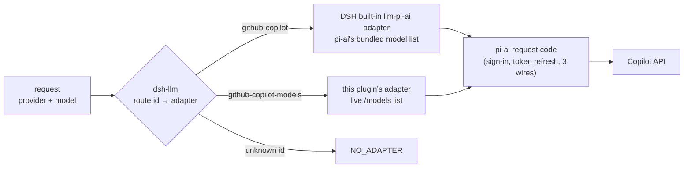

# Overview

A DeepSeek Harness (DSH) plugin that serves GitHub Copilot models. Two components:

| Component | Does | Design |
|---|---|---|
| Login | Signs in by browser device code or by personal access token (PAT), and looks up the account's Copilot host | [login.md](login.md) |
| Models | Fetches the account's model list from Copilot's `GET /models`, shows every row on the settings card with an on/off toggle, and serves the switched-on models through the plugin's own route | [models.md](models.md) |

What the user sees of both, the Card's location, layout and text, is in [ui.md](ui.md).

## Scope

Version 1 is Login, by browser and by PAT, and Models. Everything still to do is in one list: [todo.md](../todo.md).

Planned, not started:

| Plan | State | Design |
|---|---|---|
| Sign in, sign out and check the Copilot login from a chat command, in the DSH Web UI and the `dsh` terminal UI, not only on the Card | Draft; details to be filled in later | [command.md](command.md) |
| Serve DSH web search through Copilot | Notes from the reference repos; whether it ships in version 1 is open | [search.md](search.md) |

Not in version 1:

| Topic | Notes |
|---|---|
| Quota display | [quota.md](quota.md) |
| Multi-account | Not planned: no account pooling or failover |
| GitHub Enterprise Server | No reference repo supports it |
| Gemini tool-schema fix | The Copilot Gemini route answers a plain-text 400 when a tool schema lacks `properties` (P29 in [ref-similar-plugins.md](../study/ref-similar-plugins.md#7-pitfalls)). `dsh-copilot-tool-schema` adds `properties: {}` through a global `system-prompt/assemble` hook |
| Compaction beyond DSH's own | `dsh-github-copilot` has one: a request budget, a pressure ratio of 0.9, and an `agent/pre-step` listener that asks DSH to compact |
| Other providers (Codex, Claude, Grok) | Copilot only |

**Principles:** keep no stored model list; never patch pi-ai's shared catalog, `node_modules` or DSH core; keep upkeep as small as possible. The accepted cost: the code that turns a `/models` row into a model entry, the request headers, and an adapter that depends on DSH internals.

## Versions

The design documents in this folder are written against these versions:

| Component | Version |
|---|---|
| pi-ai (`@earendil-works/pi-ai`) | 1.4.0 |
| DeepSeek Harness (`@deepseek-ai/*`) | 0.2.1-rc.5 |

The plugin requires DSH `>=0.2.2-rc.1 <0.3.0-0` (`engines.dsh` in `package.json`; DSH compatibility in [Plugin basics](#plugin-basics)). The contract tests pass on DSH 0.2.2-rc.1, which carries pi-ai 1.5.0. [models.md](models.md) part B has been re-read against both, and the Models card has been checked on web-dev ([ui.md](ui.md)). The other documents have not been fully re-read against them.

## Names

| Name | Value | State |
|---|---|---|
| Route id | `github-copilot-models` | Decided |
| Repository | `dsh-github-copilot-models` (this folder) | Current |
| npm package | `dsh-github-copilot-models`, the same as the repository | Decided |
| Display name in the picker | "GitHub Copilot (plugin)", because DSH's built-in route is named "GitHub Copilot" ([models.md](models.md) A8) | Decided |

The route id matches the repository name without the `dsh-` prefix. Renaming the route id later forces users to re-pick their default model, because DSH saves the route id with it.

## Route id

The route id is the `provider` name every model request carries, for example `{ provider: 'github-copilot-models', model: 'claude-sonnet-5.5' }`. DSH's model service (`dsh-llm`) keeps one table of route id → adapter, and sends each request to the adapter registered for its id.

**Rules** (read in `dsh-llm` and `dsh-llm-pi-ai`, DSH 0.2.1-rc.5):
- **One owner per id.** A second `ctx.llm.registerAdapter` for a taken id fails with `DUPLICATE_ADAPTER`. It neither overwrites nor inherits: the first owner keeps serving. An id is freed only when its owner unloads.
- **The built-in route `github-copilot` belongs to DSH's `llm-pi-ai`.** It registers the id only while the user's settings contain `llm-pi-ai.providers.github-copilot`, which the user can add at any time on DSH's Models page. If another plugin holds the id then, `llm-pi-ai` refuses its whole route set, and every pi-ai provider change fails until the conflict is removed.
- **An id must be a lowercase hyphenated identifier** (`^[a-z][a-z0-9-]*$`) to have a stored credential record.

**What its own id gives the plugin:**
- A new provider in the model picker, beside DSH's built-in Copilot route. Both can be on at once.
- Both read the same sign-in: the credential record of DSH's built-in route, whose key the plugin asks DSH for ([login.md](login.md) B3). One sign-in or sign-out affects both.
- The plugin's adapter, a subclass of DSH's `PiAiAdapter`, reuses pi-ai's request code, sign-in and token refresh. The plugin owns only the model list, the limits, the headers and each model's label in the picker ([models.md](models.md) A8, A9).
- pi-ai finds a credential by route id, so the adapter reads the shared record through a credential store of its own ([models.md](models.md) A8, B6).
- pi-ai adds `X-Initiator` and `Openai-Intent` only for the provider id `github-copilot`. The plugin's adapter adds them itself with pi-ai's own `buildCopilotDynamicHeaders`, so they match DSH's built-in route ([models.md](models.md) A8).

**Why not `github-copilot`:** configuring DSH's built-in route limits the models to pi-ai's bundled list, and registering the plugin's own adapter on that id competes with DSH. Six other plugins do the latter and each needs a workaround: skipping registration, failing with an error, deleting the user's settings entry, or turning off DSH's `llm-pi-ai` row ([scan-similar-plugins.md](../study/scan-similar-plugins.md#route-ids-checked-in-code)).

**Ids other plugins use** (checked in their code): `github-copilot` (17 plugins), `copilot` (10, including dsh-plugin-subscriptions), `copilot-oauth` (3), and one plugin each for `github-copilot-preview`, `github-copilot-oauth`, `pi-github-copilot`, `oauth-copilot`, `dsh-plugin-subhub-github`, `github-copilot-sdk`, `github-copilot-acp` and `copilot-api`. No plugin uses `github-copilot-models`. Full list: [scan-similar-plugins.md](../study/scan-similar-plugins.md#route-ids-checked-in-code).

## Plugin basics

| Item | Value | See |
|---|---|---|
| Model requests | A subclass of DSH's `PiAiAdapter` that adds picker labels, registered with `ctx.llm.registerAdapter(['github-copilot-models'], adapter)` | [models.md](models.md) A8, A9 |
| Model list | Live `GET /models`, kept in memory only, with the user's toggles applied | [models.md](models.md) A3, A4 |
| Credential | DSH credentials service, the record of DSH's built-in route `github-copilot` (key from DSH's `recordKeyFor`), shared with that route | [login.md](login.md) A2, B3 |
| Sign-in | pi-ai's own flow through `ctx.authorization.begin()`. Never a second flow for the same key (`DUPLICATE_FLOW`) | [login.md](login.md) A4, A5 |
| Integration id | `Copilot-Integration-Id` per sign-in method: with a PAT, Copilot requires `copilot-developer-cli`; browser sign-in uses `vscode-chat`, the value pi-ai sends. One constant, `INTEGRATION_ID` in `src/shared/api.ts`, feeds the requests and the Card | [login.md](login.md) A5, [models.md](models.md) A1, [ui.md](ui.md) U3 |
| Settings | Only the plugin's own `Config`: `domain`, `modelVisibility`, `modelLimits`, `customHeaders` | [login.md](login.md) A1, [models.md](models.md) A5, A6 |
| Card ↔ Host | `ctx.connection.fetch.register`, which DSH authenticates | [login.md](login.md), Terms |
| Card location | Open: Settings, the Plugins page or the Models page | [ui.md](ui.md) U1 |
| Bundle patch | Insert only the plugin's own row. Never insert a service the base bundle already mounts, and never turn off the shared `llm-pi-ai` row | [packaging.md](../packaging.md#1-how-the-plugin-is-packaged) |
| DSH compatibility | `engines.dsh` and the `dsh-llm` and `dsh-llm-pi-ai` peers allow the range `>=0.2.2-rc.1 <0.3.0-0`. It starts at the version the type checker and the contract tests use. The Models adapter depends on DSH internals (`PiAiAdapter`'s options and profile fields, [models.md](models.md) B6), so a release inside the range can still break it: 0.2.2-rc.1 adds two required profile fields, `maxRequestImages` and `imageOffloadCountQuantum`. Run the contract tests on each new DSH before relying on it. Other policies: [packaging.md](../packaging.md#2-compatibility) | `package.json`; [packaging.md](../packaging.md) |
| Testing | In place, in a profile that has this folder as a local link, or on a separate development profile such as `web-dev`. Credentials are stored per DSH home, not per profile, so a sign-in on any profile changes the record every profile in the same DSH home sees | [DEVELOPMENT.md](../../DEVELOPMENT.md#3-profiles) 3 |

## Risks

| Risk | Likelihood | Impact | Mitigation |
|---|---|---|---|
| A DSH release breaks the plugin | high | high | Small contact surface, contract tests on each release ([packaging.md](../packaging.md#2-compatibility)) |
| pi-ai changes the record, the flow or the prompt | medium | high | A test that fails on a second prompt, read-back of any record the plugin writes ([login.md](login.md) B7) |
| Copilot rejects the request headers | medium | high | pi-ai's Copilot headers, so a pi-ai update brings new values ([models.md](models.md) A8), and the integration id per sign-in method (above) |
| The Copilot API has no published spec and can change without notice | high | medium | Keep the plugin thin, fail open, map defensively |
| Automated or repeated requests trigger an account block | unknown | high | Few requests, no probing loops, and only to the account's own Copilot host ([login.md](login.md) A3) |
| The `/models` rules drift; the reference repos already disagree on filters and limits | medium | medium | Rules as data with fixed rejection codes, never guessing metadata |
| Personal (Individual, Pro, Free) accounts behave differently; only one Business account has been tested | unknown | high | Test with a personal account ([todo.md](../todo.md)) |
